# First waves-on v4 results — 2026-10-09

_Generated by `scripts/v4_first_results.py report`; tables are auto-filled, every **TODO** is prose for the main session. HWM numbers: estimator **median**, radius **50 m**, q ≤ 2, dry marks scored against ground (the `_scored` keys)._

## The short version

The re-frozen v4 with waves on is the new v4 reference: HWM RMSE **0.479 m**, bias −0.174 m (median, 50 m, n 110), MOTF CSI 0.713. Waves help it by ΔRMSE **−0.060 m** [−0.115, −0.019], almost all in the NY bays (−0.148). The NACCS-blend wind helps by a similar amount: −0.049 [−0.084, −0.023] waves-off, mostly in the NY bays and the Delaware. Taken together (`rfw_on`, RMSE 0.436), they are the best v4 so far.

Two things look wrong:
- **The `rf_on` solve was preempted.** It resumed at 10-29 12:00 with the curve-number soil reset to dry, so it soaks up Sandy's later rain. That hides the wave lift at the four `south_coast` rain-pond marks, and it flatters every `rfw_on − rf_on` row there (the NACCS twin ran straight through).
- **v4 still trails v3 by +0.18 m RMSE on the 94 shared marks.** The gap sits in a few rain-pond basins. The no-infiltration test (STATUS) says most of it is the curve-number infiltration, not the sea.

## What ran

| label | role | domain | arm | engine | waves | dtwave_s | dtheta_deg | ig | rain | infiltration | subgrid | solve_wall_h | sim_h_per_wall_h | nodes | constraint | audit | seal |
|---|---|---|---|---|---|---|---|---|---|---|---|---|---|---|---|---|---|
| rf_on | v4 re-freeze, waves ON | v4_refreeze | naccs-premier | bin:v2.3.3-winddir-fix-1-gf11@673ee3bf | ON | 3600.0 | 5.0 | 1 | on | cna | _subgrid_refreeze@b6f29ad1 | 11.16 | 6.45 | hal0384,hal0433 | emeraldrapids | output WHOLE | 4881654 faces, sha 378014e154b4ff41; sealed |
| rf_off | v4 re-freeze, waves-off twin | v4_refreeze | naccs-nowaves | bin:v2.3.3-winddir-fix-1-gf11@673ee3bf | off |  |  |  | on | cna | _subgrid_refreeze@b6f29ad1 | 2.21 | 32.63 | hal0340 |  | output WHOLE | 4881654 faces, sha 378014e154b4ff41; sealed |
| rfw_on | v4 re-freeze, NACCS-blend wind, waves ON | v4_refreeze | wind-naccs+naccs-premier | bin:v2.3.3-winddir-fix-1-gf11@673ee3bf | ON | 3600.0 | 5.0 | 1 | on | cna | _subgrid_refreeze@b6f29ad1 | 10.08 | 7.14 | hal0395 | emeraldrapids | output WHOLE | 4881654 faces, sha 378014e154b4ff41; sealed |
| rfw_off | v4 re-freeze, NACCS-blend wind, waves off | v4_refreeze | wind-naccs+naccs-nowaves | bin:v2.3.3-winddir-fix-1-gf11@673ee3bf | off |  |  |  | on | cna | _subgrid_refreeze@b6f29ad1 | 2.20 | 32.76 | hal0340 |  | output WHOLE | 4881654 faces, sha 378014e154b4ff41; sealed |
| B_on | run B, waves ON | v4_hot_plus_walls | naccs-premier | bin:v2.3.3-winddir-fix-1-gf11@673ee3bf | ON | 3600.0 | 5.0 | 1 | on | cna | _subgrid_premier@45f1cc26 | 9.42 | 7.65 | hal0441 | emeraldrapids | output WHOLE | 4881654 faces, sha 77b5eda1fcd51cf6; sealed |
| B_off | run B's waves-off twin | v4_hot_plus_walls | naccs-nowaves | bin:v2.3.3-winddir-fix-1-gf11@673ee3bf | off |  |  |  | on | cna | _subgrid_premier@45f1cc26 | 1.56 | 46.28 | hal0397 |  | output WHOLE | 4881654 faces, sha 77b5eda1fcd51cf6; sealed |
| v3fix_on | v3 re-run: the shared bed fixes, hourly waves | v3 | bed-v4fixes+wave-dt3600 | bin:v2.3.3-winddir-fix-1-gf11@673ee3bf | ON | 3600.0 | 5.0 | 1 | on | none | _subgrid_v4fixes@183ce59b | 14.70 | 4.90 | hal0396 | emeraldrapids | output WHOLE | 3412470 faces, sha 1596ce1ecc71b374; sealed |
| v3fix_off | v3 re-run's waves-off twin | v3 | bed-v4fixes+naccs-nowaves | bin:v2.3.3-winddir-fix-1-gf11@673ee3bf | off |  |  |  | on | none | _subgrid_v4fixes@183ce59b | 0.94 | 76.75 | hal0276 |  | output WHOLE | 3412470 faces, sha 1596ce1ecc71b374; sealed |


## Headline scores (metrics.csv)

HWM on the `_scored` keys; MOTF CSI/POD/FAR with `extent_admissible` (False = waves-off: keep, do not rank against waves-on) and `motf_km2_excluded_boxes` (v3 and v4 score DIFFERENT MOTF rasters — CSI is not comparable across domains).

| label | domain | arm | hwm_estimator | hwm_radius_m | hwm_n_scored | hwm_n_dry_scored | hwm_bias_scored_m | hwm_rmse_scored_m | hwm_within0.5_scored | motf_csi | motf_pod | motf_far | extent_admissible | motf_km2_excluded_boxes | motf_km2_excluded_invalid | motf_csi_connected | motf_far_connected |
|---|---|---|---|---|---|---|---|---|---|---|---|---|---|---|---|---|---|
| rf_on | v4_refreeze | naccs-premier | median | 50.000 | 110 | 1 | -0.174 | 0.479 | 0.873 | 0.713 | 0.803 | 0.136 | True | 2046.574 | 2046.574 | 0.743 | 0.092 |
| rf_off | v4_refreeze | naccs-nowaves | median | 50.000 | 110 | 3 | -0.361 | 0.539 | 0.755 | 0.698 | 0.791 | 0.144 | False | 2046.574 | 2046.574 | 0.732 | 0.094 |
| rfw_on | v4_refreeze | wind-naccs+naccs-premier | median | 50.000 | 110 | 1 | -0.110 | 0.436 | 0.909 | 0.728 | 0.847 | 0.162 | True | 2046.574 | 2046.574 | 0.764 | 0.113 |
| rfw_off | v4_refreeze | wind-naccs+naccs-nowaves | median | 50.000 | 110 | 3 | -0.240 | 0.490 | 0.836 | 0.718 | 0.823 | 0.152 | False | 2046.574 | 2046.574 | 0.751 | 0.104 |
| B_on | v4_hot_plus_walls | naccs-premier | median | 50.000 | 110 | 1 | -0.257 | 0.498 | 0.818 | 0.707 | 0.810 | 0.152 | True | 2048.704 | 2048.704 | 0.747 | 0.094 |
| B_off | v4_hot_plus_walls | naccs-nowaves | median | 50.000 | 110 | 2 | -0.387 | 0.567 | 0.691 | 0.691 | 0.783 | 0.145 | False | 2048.704 | 2048.704 | 0.727 | 0.090 |
| v3fix_on | v3 | bed-v4fixes+wave-dt3600 | median | 50.000 | 94 | 0 | -0.157 | 0.323 | 0.915 | 0.713 | 0.886 | 0.215 | True | 14.038 | 0.000 | 0.815 | 0.090 |
| v3fix_off | v3 | bed-v4fixes+naccs-nowaves | median | 50.000 | 94 | 1 | -0.250 | 0.382 | 0.840 | 0.705 | 0.861 | 0.205 | False | 14.038 | 0.000 | 0.802 | 0.079 |


Waves on beats waves off in every pair: RMSE drops by 0.05–0.07 m, bias rises by 0.13–0.19 m, CSI rises by 0.01–0.02. The re-freeze beats run B on both twins: the Keansburg levee is back, the meteo corner and the Lewes edge are fixed, and the bed overlays are in. The NACCS-blend wind beats ERA5 on both twins. It also raises POD and FAR together (0.803 → 0.847, 0.136 → 0.162), so it wets more ground, both truly and falsely. One dry mark remains with waves on and three with waves off. CSI is not comparable across domains: v3 and v4 score different MOTF rasters, with 14 vs 2,047 km² excluded.


## Paired comparisons (per-mark, bootstrap)

Δ = A − B. ΔRMSE < 0 means A fits the marks better. Δ mean / Δ median = change in modelled level at the marks (positive = A higher). ALL row = `paired_hwm_bootstrap.py` main read (B = 200 000, seed 20261007); groups = its `--by-basin` read. Cross-domain pairs are joined on `hwm_id` over the marks scored in both (v3's area).

| pair | why | domains | n | rmse_a | rmse_b | drmse_m | drmse_lo | drmse_hi | p_a_better | bias_a | bias_b | dmean_m | dmedian_m |
|---|---|---|---|---|---|---|---|---|---|---|---|---|---|
| rf_on − rf_off | wave contribution, re-freeze | v4_refreeze / v4_refreeze | 110 | +0.4787 | +0.5390 | -0.0602 | -0.1153 | -0.0188 | +0.9976 | -0.1743 | -0.3606 | +0.1863 | +0.1686 |
| rfw_off − rf_off | NACCS-blend wind vs ERA5, waves off | v4_refreeze / v4_refreeze | 110 | +0.4900 | +0.5390 | -0.0489 | -0.0839 | -0.0230 | +0.9999 | -0.2401 | -0.3606 | +0.1205 | +0.0708 |
| rfw_on − rf_on | NACCS-blend wind vs ERA5, waves on | v4_refreeze / v4_refreeze | 110 | +0.4359 | +0.4787 | -0.0428 | -0.0958 | -0.0052 | +0.9890 | -0.1102 | -0.1743 | +0.0642 | +0.0338 |
| rf_on − B_on | re-freeze vs run B, waves on (weir, meteo corner, Lewes) | v4_refreeze / v4_hot_plus_walls | 110 | +0.4787 | +0.4979 | -0.0192 | -0.0743 | +0.0293 | +0.7937 | -0.1743 | -0.2572 | +0.0829 | +0.0548 |
| rf_off − B_off | re-freeze vs run B, waves off | v4_refreeze / v4_hot_plus_walls | 110 | +0.5390 | +0.5670 | -0.0281 | -0.0635 | -0.0024 | +0.9854 | -0.3606 | -0.3866 | +0.0260 | +0.0230 |
| rf_on − v3fix_on | v4 re-freeze vs v3, shared fixes, hourly waves | v4_refreeze / v3 | 94 | +0.5041 | +0.3234 | +0.1807 | +0.0050 | +0.3429 | +0.0205 | -0.1765 | -0.1570 | -0.0196 | +0.0388 |
| rf_off − v3fix_off | v4 re-freeze vs v3, shared fixes, waves off | v4_refreeze / v3 | 94 | +0.5633 | +0.3821 | +0.1812 | +0.0470 | +0.3266 | +0.0003 | -0.3678 | -0.2500 | -0.1177 | -0.0318 |


### By basin group

| pair | unit | n | drmse_m | drmse_lo | drmse_hi | dmean_m | dmean_lo | dmean_hi | dmedian_m | bias_a | bias_b |
|---|---|---|---|---|---|---|---|---|---|---|---|
| rf_on − rf_off | [open coast] | 23 | +0.014 | -0.127 | +0.114 | +0.130 | +0.056 | +0.187 | +0.148 | -0.269 | -0.399 |
| rf_on − rf_off | [inlets] | 14 | -0.067 | -0.119 | -0.031 | +0.107 | +0.060 | +0.153 | +0.094 | -0.280 | -0.387 |
| rf_on − rf_off | [NY bays] | 46 | -0.148 | -0.244 | -0.059 | +0.261 | +0.214 | +0.310 | +0.215 | -0.035 | -0.296 |
| rf_on − rf_off | [NJ back bays] | 19 | -0.053 | -0.131 | -0.013 | +0.146 | +0.118 | +0.172 | +0.183 | -0.321 | -0.468 |
| rf_on − rf_off | [rivers / Newark Bay] | 7 | -0.072 | -0.175 | -0.018 | +0.163 | +0.088 | +0.235 | +0.184 | -0.143 | -0.305 |
| rfw_off − rf_off | [open coast] | 23 | -0.001 | -0.012 | +0.005 | -0.002 | -0.014 | +0.013 | -0.001 | -0.401 | -0.399 |
| rfw_off − rf_off | [inlets] | 14 | -0.022 | -0.051 | -0.004 | +0.039 | +0.010 | +0.070 | +0.015 | -0.349 | -0.387 |
| rfw_off − rf_off | [NY bays] | 46 | -0.118 | -0.203 | -0.036 | +0.198 | +0.154 | +0.243 | +0.168 | -0.098 | -0.296 |
| rfw_off − rf_off | [NJ back bays] | 19 | -0.020 | -0.070 | +0.013 | +0.069 | +0.027 | +0.107 | +0.089 | -0.399 | -0.468 |
| rfw_off − rf_off | [rivers / Newark Bay] | 7 | -0.182 | -0.253 | -0.089 | +0.280 | +0.208 | +0.359 | +0.256 | -0.025 | -0.305 |
| rfw_on − rf_on | [open coast] | 23 | -0.115 | -0.315 | -0.015 | +0.070 | +0.010 | +0.163 | +0.010 | -0.199 | -0.269 |
| rfw_on − rf_on | [inlets] | 14 | -0.019 | -0.036 | -0.005 | +0.064 | +0.034 | +0.095 | +0.051 | -0.217 | -0.280 |
| rfw_on − rf_on | [NY bays] | 46 | +0.016 | -0.026 | +0.046 | +0.028 | +0.007 | +0.049 | +0.027 | -0.007 | -0.035 |
| rfw_on − rf_on | [NJ back bays] | 19 | -0.031 | -0.073 | +0.029 | +0.094 | +0.051 | +0.130 | +0.111 | -0.228 | -0.321 |
| rfw_on − rf_on | [rivers / Newark Bay] | 7 | -0.127 | -0.224 | +0.030 | +0.159 | +0.076 | +0.240 | +0.185 | +0.016 | -0.143 |
| rf_on − B_on | [open coast] | 23 | +0.085 | -0.052 | +0.227 | -0.000 | -0.084 | +0.059 | +0.041 | -0.269 | -0.269 |
| rf_on − B_on | [inlets] | 14 | -0.029 | -0.056 | -0.003 | +0.035 | -0.003 | +0.062 | +0.042 | -0.280 | -0.315 |
| rf_on − B_on | [NY bays] | 46 | -0.128 | -0.170 | -0.080 | +0.145 | +0.093 | +0.195 | +0.151 | -0.035 | -0.180 |
| rf_on − B_on | [NJ back bays] | 19 | +0.006 | -0.056 | +0.040 | +0.046 | +0.013 | +0.081 | +0.028 | -0.321 | -0.368 |
| rf_on − B_on | [rivers / Newark Bay] | 7 | -0.127 | -0.198 | -0.073 | +0.197 | +0.158 | +0.239 | +0.192 | -0.143 | -0.340 |
| rf_off − B_off | [open coast] | 23 | +0.024 | -0.039 | +0.072 | +0.002 | -0.045 | +0.043 | +0.016 | -0.399 | -0.401 |
| rf_off − B_off | [inlets] | 14 | -0.030 | -0.059 | -0.008 | +0.031 | +0.000 | +0.061 | +0.016 | -0.387 | -0.418 |
| rf_off − B_off | [NY bays] | 46 | -0.068 | -0.134 | -0.019 | +0.022 | -0.016 | +0.053 | +0.021 | -0.296 | -0.318 |
| rf_off − B_off | [NJ back bays] | 19 | -0.016 | -0.059 | +0.014 | +0.041 | +0.001 | +0.076 | +0.048 | -0.468 | -0.508 |
| rf_off − B_off | [rivers / Newark Bay] | 7 | -0.091 | -0.122 | -0.065 | +0.094 | +0.063 | +0.130 | +0.094 | -0.305 | -0.400 |
| rf_on − v3fix_on | [open coast] | 23 | +0.383 | -0.031 | +0.633 | -0.149 | -0.359 | +0.014 | +0.022 | -0.269 | -0.119 |
| rf_on − v3fix_on | [inlets] | 14 | +0.027 | -0.041 | +0.143 | -0.036 | -0.160 | +0.054 | -0.008 | -0.280 | -0.244 |
| rf_on − v3fix_on | [NY bays] | 38 | -0.047 | -0.171 | +0.040 | +0.124 | +0.079 | +0.175 | +0.111 | -0.010 | -0.134 |
| rf_on − v3fix_on | [NJ back bays] | 19 | +0.320 | -0.014 | +0.736 | -0.137 | -0.432 | +0.037 | -0.011 | -0.321 | -0.184 |
| rf_off − v3fix_off | [open coast] | 23 | +0.309 | +0.005 | +0.542 | -0.149 | -0.318 | -0.014 | -0.007 | -0.399 | -0.250 |
| rf_off − v3fix_off | [inlets] | 14 | +0.012 | -0.051 | +0.109 | -0.023 | -0.145 | +0.069 | -0.004 | -0.387 | -0.364 |
| rf_off − v3fix_off | [NY bays] | 38 | +0.078 | -0.008 | +0.165 | -0.114 | -0.175 | -0.052 | -0.093 | -0.292 | -0.177 |
| rf_off − v3fix_off | [NJ back bays] | 19 | +0.294 | -0.002 | +0.697 | -0.156 | -0.444 | +0.011 | -0.008 | -0.468 | -0.312 |


Per-basin rows: `paired.csv`.


**Waves.** With waves on, the modelled level rises by 0.11–0.26 m at the marks in every group. The fit improves everywhere except the open coast, which is flat (+0.014 [−0.127, +0.114]). There the four `south_coast` rain-pond marks fall by 0.03 m instead of rising, because of the soil-state reset in `rf_on`. In the NY bays the lift is largest (+0.26 m, ΔRMSE −0.148), but part of it is the waves-on bay seiche and run-to-run noise (FINDINGS §44, §61). Read NY-bay waves-on crests to about ±0.1–0.15 m.

**Re-freeze vs run B.** Overall the gain is within noise: −0.019 [−0.074, +0.029] waves on. It is clear where the fixes act: the NY bays −0.128 (Keansburg levee, harbour bed) and the rivers / Newark Bay −0.127. The open coast doesn't move. The waves-off pair is cleaner, −0.028 [−0.064, −0.002].

**NACCS wind vs ERA5.** Read it waves off (`rfw_off − rf_off`, both uninterrupted): NY bays −0.118, rivers / Newark Bay −0.182, the open coast unchanged. The Delaware gauges rise by 0.16–0.27 m. The waves-on pair carries the soil reset: its open-coast −0.115 is the four `south_coast` marks.

**v4 vs v3 on the 94 shared marks.** v4 trails by +0.181 waves on and +0.181 waves off. The gap comes from the open coast (+0.38 / +0.31) and the NJ back bays (+0.32 / +0.29), with wide intervals, so a handful of marks drive it. In the NY bays v4 is level or better with waves on (−0.047). The per-basin bias rows locate it: `south_coast` (v4 −1.3 vs v3 −0.4/−0.5), `barnegat_bay` (−0.65 vs −0.21) and `shark_river` (−0.61 vs −0.31). These are the rain-pond basins of FINDINGS part 4 (d). v3 runs without infiltration; v4 uses the curve-number method.


### Residual self-check (per-mark recompute vs the metrics.csv row)

| label | n | rmse | bias | metrics_n | metrics_rmse | metrics_bias | metrics_estimator | metrics_radius | reproduces_metrics_4dp |
|---|---|---|---|---|---|---|---|---|---|
| B_off | 110 | 0.5670 | -0.3866 | 110 | 0.5670 | -0.3866 | median | 50.0000 | True |
| B_on | 110 | 0.4979 | -0.2572 | 110 | 0.4979 | -0.2572 | median | 50.0000 | True |
| rf_off | 110 | 0.5390 | -0.3606 | 110 | 0.5390 | -0.3606 | median | 50.0000 | True |
| rf_on | 110 | 0.4787 | -0.1743 | 110 | 0.4787 | -0.1743 | median | 50.0000 | True |
| rfw_off | 110 | 0.4900 | -0.2401 | 110 | 0.4900 | -0.2401 | median | 50.0000 | True |
| rfw_on | 110 | 0.4359 | -0.1102 | 110 | 0.4359 | -0.1102 | median | 50.0000 | True |
| v3fix_off | 94 | 0.3821 | -0.2500 | 94 | 0.3821 | -0.2500 | median | 50.0000 | True |
| v3fix_on | 94 | 0.3234 | -0.1570 | 94 | 0.3234 | -0.1570 | median | 50.0000 | True |


## Gauges (peak, model − obs, m)

† = the gauge died mid-storm; model compared to its last good sample.


| index | obs_peak | rf_on | rf_off | rfw_on | rfw_off | B_on | B_off | v3fix_on | v3fix_off |
|---|---|---|---|---|---|---|---|---|---|
| noaa_atlantic_city | +1.88 | +0.53 | +0.47 | +0.53 | +0.47 | +0.52 | +0.46 | +0.55 | +0.49 |
| noaa_brandywine_shoal † | +1.54 | -0.07 | -0.05 | -0.13 | -0.13 | -0.01 | -0.03 |  |  |
| noaa_burlington | +2.48 | -0.48 | -0.43 | -0.13 | -0.17 | -0.50 | -0.50 |  |  |
| noaa_cape_may | +1.75 | -0.13 | -0.15 | -0.04 | -0.20 | -0.11 | -0.13 | -0.23 | -0.23 |
| noaa_delaware_city | +2.05 | -0.43 | -0.44 | -0.22 | -0.23 | -0.47 | -0.47 |  |  |
| noaa_lewes | +1.85 | -0.20 | -0.21 | -0.19 | -0.23 | -0.22 | -0.23 |  |  |
| noaa_marcus_hook | +2.17 | -0.46 | -0.50 | -0.19 | -0.24 | -0.56 | -0.56 |  |  |
| noaa_newbold | +2.56 | -0.45 | -0.44 | -0.13 | -0.17 | -0.48 | -0.48 |  |  |
| noaa_philadelphia | +2.29 | -0.43 | -0.43 | -0.14 | -0.20 | -0.55 | -0.53 |  |  |
| noaa_reedy_point | +1.87 | -0.25 | -0.26 | -0.10 | -0.11 | -0.29 | -0.29 |  |  |
| noaa_ship_john_shoal | +1.90 | -0.34 | -0.35 | -0.07 | -0.07 | -0.25 | -0.34 |  |  |
| sandy_hook † | +2.81 | -0.16 | -0.19 | -0.16 | -0.15 | -0.23 | -0.19 | +0.03 | -0.20 |
| sss_arthur_kill_mouth | +3.81 | +0.24 | -0.25 | +0.16 | +0.11 | -0.15 | -0.28 | -0.32 | -0.23 |
| sss_cape_may † | +2.24 | -0.68 | -0.69 | -0.62 | -0.64 | -0.70 | -0.70 | -0.56 | -0.55 |
| sss_great_bay | +2.39 | -0.23 | -0.41 | -0.03 | -0.23 | -0.24 | -0.42 | -0.22 | -0.33 |
| sss_great_egg | +2.10 | -0.09 | -0.18 | -0.08 | -0.17 | -0.10 | -0.17 | -0.06 | -0.13 |
| sss_great_kills | +3.99 | -0.30 | -0.55 | -0.26 | -0.36 | -0.40 | -0.57 | -0.47 | -0.51 |
| sss_narrows_bkln | +3.32 | +0.07 | +0.03 | +0.09 | +0.06 | +0.14 | +0.04 | +0.03 | +0.09 |
| sss_narrows_si | +3.42 | +0.02 | -0.03 | +0.01 | -0.00 | +0.03 | -0.04 | -0.03 | -0.05 |
| usgs_stormtide_sea_bright | +3.47 | -0.59 | -0.67 | -0.55 | -0.66 | -0.61 | -0.67 | -0.56 | -0.67 |
| usgs_tidal_absecon_channel † | +1.56 | -0.42 | -0.48 | -0.41 | -0.47 | -0.45 | -0.51 | -0.48 | -0.51 |
| usgs_tidal_absecon_creek † | +1.87 | -0.26 | -0.34 | -0.21 | -0.29 | +0.55 | +0.55 | +1.03 | +1.03 |
| usgs_tidal_avalon † | +1.14 | -0.59 | -0.63 | -0.59 | -0.63 | +0.79 | +0.72 | +0.77 | +0.71 |
| usgs_tidal_barnegat_light | +1.59 | +0.28 | +0.08 | +0.24 | +0.03 | +0.32 | +0.11 | +0.31 | +0.09 |
| usgs_tidal_bivalve † | +1.39 | -0.04 | -0.04 | -0.07 | -0.10 | -0.03 | -0.03 |  |  |
| usgs_tidal_cape_may_harbor † | +1.80 | -0.12 | -0.12 | -0.12 | -0.12 | -0.06 | -0.10 | -0.15 | -0.19 |
| usgs_tidal_christina_newport | +2.56 | -0.95 | -0.92 | -0.73 | -0.79 | -0.35 | -0.36 |  |  |
| usgs_tidal_christina_wilmington | +2.52 | -0.89 | -0.86 | -0.57 | -0.64 | -0.90 | -0.90 |  |  |
| usgs_tidal_greenwich † | +1.29 | -0.33 | -0.36 | -0.36 | -0.40 | -0.25 | -0.27 |  |  |
| usgs_tidal_inside_thorofare † | +1.71 | -0.31 | -0.37 | -0.32 | -0.37 | +0.54 | +0.43 | +0.52 | +0.44 |
| usgs_tidal_keansburg † | +1.59 | +0.00 | -0.32 | -0.25 | -0.30 | -0.16 | -0.32 |  |  |
| usgs_tidal_manasquan_pp † | +1.33 | -0.16 | -0.22 | -0.15 | -0.22 | -0.17 | -0.22 |  |  |
| usgs_tidal_mantoloking | +2.11 | -0.19 | -0.39 | -0.06 | -0.27 | -0.24 | -0.46 | -0.16 | -0.35 |
| usgs_tidal_murderkill_bowers | +1.48 | +0.09 | +0.05 | +0.04 | +0.03 | +0.23 | +0.11 |  |  |
| usgs_tidal_murderkill_frederica | +1.21 | -0.10 | +0.02 | +0.04 | +0.00 | +0.09 | +0.04 |  |  |
| usgs_tidal_new_castle † | +1.92 | -0.45 | -0.32 | -0.10 | -0.18 | -0.36 | -0.38 |  |  |
| usgs_tidal_newark_bay | +3.70 | -0.07 | -0.14 | -0.07 | -0.08 | -0.17 | -0.19 |  |  |
| usgs_tidal_ocean_city | +2.21 | -0.06 | -0.17 | -0.07 | -0.17 | -0.08 | -0.16 | -0.08 | -0.14 |
| usgs_tidal_pt_pleasant_canal † | +1.70 | +0.10 | +0.01 | +0.08 | +0.00 | +0.25 | +0.20 |  |  |
| usgs_tidal_sea_bright † | +1.38 | -0.15 | -0.29 | -0.24 | -0.28 | -0.29 | -0.39 | -0.34 | -0.36 |
| usgs_tidal_sea_isle † | +1.58 | -0.48 | -0.57 | -0.46 | -0.55 | +0.36 | +0.21 | +0.35 | +0.23 |
| usgs_tidal_shark_river † | +1.53 | -0.32 | -0.32 | -0.31 | -0.32 | -0.36 | -0.36 | -0.38 | -0.36 |
| usgs_tidal_ship_bottom † | +1.02 | -0.20 | -0.29 | -0.22 | -0.31 | +0.79 | +0.60 | +0.74 | +0.58 |
| usgs_tidal_sluice_creek | +1.83 | -0.45 | -0.39 | +0.16 | +0.04 | -0.33 | -0.47 |  |  |
| usgs_tidal_south_amboy † | +4.09 | -0.03 | -0.48 | -0.00 | -0.06 | -0.37 | -0.52 |  |  |
| usgs_tidal_stone_harbor † | +1.55 | -0.36 | -0.44 | -0.36 | -0.45 | +0.32 | +0.23 | +0.31 | +0.24 |
| usgs_tidal_tuckerton † | +1.59 | -0.20 | -0.28 | -0.19 | -0.28 | +0.64 | +0.50 | +0.60 | +0.51 |
| usgs_tidal_waretown | +1.68 | +0.03 | -0.16 | +0.07 | -0.13 | +0.06 | -0.14 |  |  |


Waves lift the peak most at South Amboy (+0.45), the Arthur Kill mouth (+0.50), Keansburg (+0.32) and Great Kills (+0.26). Those are NY-bay gauges, where the seiche phase is part of the lift. In the NJ back bays they lift Barnegat Light (+0.21), Mantoloking (+0.20), Waretown (+0.19) and Great Bay (+0.18). The Delaware gets ~0 from waves. NACCS wind moves the Delaware instead: Philadelphia, Burlington, Newbold and Marcus Hook go from ~0.45 m low to 0.13–0.19 m low.

Worst misses on `rfw_on`:
- **Christina at Newport / Wilmington** −0.73 / −0.57: an uncarved creek, FINDINGS §60g.
- **Cape May SSS** −0.62 († died mid-storm).
- **Absecon Channel** −0.41.
- **Sea Bright storm-tide sensor** −0.55.
- **Atlantic City** +0.53 high on every run and every domain (open question in STATUS).

⚠️ **Do not compare the run B and v3 columns at seven southern back-bay gauges with the re-freeze columns.** The gauges are Inside Thorofare, Tuckerton, Absecon Creek, Avalon, Ship Bottom, Sea Isle and Stone Harbor. Only `v4_refreeze` gives them `record_ends`, so the B and v3 values (+0.3…+0.8) score a post-gap sample or a pre-storm tide. The −1.1…−1.6 m "re-freeze − B" deltas there are that scoring change, not the model (FINDINGS §60f).


## HWM by basin (metrics.csv, `_scored` keys)

| basin  | n_scored B_off | n_scored B_on | n_scored rf_off | n_scored rf_on | n_scored rfw_off | n_scored rfw_on | n_scored v3fix_off | n_scored v3fix_on | bias_scored_m B_off | bias_scored_m B_on | bias_scored_m rf_off | bias_scored_m rf_on | bias_scored_m rfw_off | bias_scored_m rfw_on | bias_scored_m v3fix_off | bias_scored_m v3fix_on | rmse_scored_m B_off | rmse_scored_m B_on | rmse_scored_m rf_off | rmse_scored_m rf_on | rmse_scored_m rfw_off | rmse_scored_m rfw_on | rmse_scored_m v3fix_off | rmse_scored_m v3fix_on |
|---|---|---|---|---|---|---|---|---|---|---|---|---|---|---|---|---|---|---|---|---|---|---|---|---|
| absecon_atlantic_city | +9.000 | +9.000 | +9.000 | +9.000 | +9.000 | +9.000 | +9.000 | +9.000 | -0.192 | -0.038 | -0.166 | +0.005 | -0.172 | +0.008 | -0.163 | -0.032 | +0.214 | +0.092 | +0.190 | +0.081 | +0.193 | +0.071 | +0.188 | +0.099 |
| arthur_kill_nj | +3.000 | +3.000 | +3.000 | +3.000 | +3.000 | +3.000 |  |  | -0.219 | -0.144 | -0.129 | +0.050 | +0.066 | +0.088 |  |  | +0.254 | +0.204 | +0.144 | +0.125 | +0.108 | +0.121 |  |  |
| atlantic_oceanfront | +3.000 | +3.000 | +3.000 | +3.000 | +3.000 | +3.000 | +3.000 | +3.000 | -0.268 | -0.173 | -0.160 | -0.062 | -0.153 | -0.053 | -0.208 | -0.093 | +0.282 | +0.194 | +0.179 | +0.106 | +0.171 | +0.099 | +0.221 | +0.187 |
| barnegat_barrier | +1.000 | +1.000 | +1.000 | +1.000 | +1.000 | +1.000 | +1.000 | +1.000 | -0.525 | -0.294 | -0.437 | -0.235 | -0.323 | -0.103 | -0.372 | -0.191 | +0.525 | +0.294 | +0.437 | +0.235 | +0.323 | +0.103 | +0.372 | +0.191 |
| barnegat_bay | +6.000 | +6.000 | +6.000 | +6.000 | +6.000 | +6.000 | +6.000 | +6.000 | -0.848 | -0.656 | -0.808 | -0.649 | -0.742 | -0.552 | -0.376 | -0.212 | +1.138 | +1.032 | +1.123 | +1.062 | +1.095 | +1.002 | +0.493 | +0.355 |
| brooklyn_breezy | +3.000 | +3.000 | +3.000 | +3.000 | +3.000 | +3.000 |  |  | -0.367 | -0.332 | -0.366 | -0.338 | -0.370 | -0.365 |  |  | +0.448 | +0.405 | +0.448 | +0.420 | +0.454 | +0.452 |  |  |
| cape_may | +2.000 | +2.000 | +2.000 | +2.000 | +2.000 | +2.000 | +2.000 | +2.000 | -0.100 | -0.063 | -0.234 | -0.102 | -0.246 | -0.033 | -0.057 | +0.024 | +0.202 | +0.154 | +0.238 | +0.147 | +0.252 | +0.169 | +0.149 | +0.171 |
| cape_may_back_bays | +4.000 | +4.000 | +4.000 | +4.000 | +4.000 | +4.000 | +4.000 | +4.000 | -0.359 | -0.262 | -0.371 | -0.265 | -0.393 | -0.290 | -0.349 | -0.267 | +0.372 | +0.281 | +0.381 | +0.279 | +0.420 | +0.319 | +0.362 | +0.286 |
| delaware_bay_shore | +1.000 | +1.000 | +1.000 | +1.000 | +1.000 | +1.000 |  |  | -0.366 | -0.073 | -0.408 | -0.356 | -0.037 | +0.037 |  |  | +0.366 | +0.073 | +0.408 | +0.356 | +0.037 | +0.037 |  |  |
| delaware_river | +2.000 | +2.000 | +2.000 | +2.000 | +2.000 | +2.000 |  |  | -0.615 | -0.629 | -0.527 | -0.493 | -0.270 | -0.201 |  |  | +0.615 | +0.629 | +0.527 | +0.494 | +0.271 | +0.203 |  |  |
| great_bay_mullica | +9.000 | +9.000 | +9.000 | +9.000 | +9.000 | +9.000 | +9.000 | +9.000 | -0.348 | -0.223 | -0.284 | -0.128 | -0.172 | +0.017 | -0.252 | -0.129 | +0.515 | +0.469 | +0.484 | +0.442 | +0.446 | +0.426 | +0.435 | +0.394 |
| great_egg | +2.000 | +2.000 | +2.000 | +2.000 | +2.000 | +2.000 | +2.000 | +2.000 | -0.305 | -0.226 | -0.360 | -0.268 | -0.380 | -0.243 | -0.280 | -0.212 | +0.349 | +0.251 | +0.379 | +0.268 | +0.393 | +0.243 | +0.326 | +0.238 |
| lbi_barrier | +4.000 | +4.000 | +4.000 | +4.000 | +4.000 | +4.000 | +4.000 | +4.000 | -0.313 | -0.128 | -0.266 | -0.065 | -0.290 | -0.076 | -0.297 | -0.117 | +0.429 | +0.338 | +0.360 | +0.244 | +0.371 | +0.229 | +0.395 | +0.305 |
| lower_bay_si_shore | +6.000 | +6.000 | +6.000 | +6.000 | +6.000 | +6.000 | +3.000 | +3.000 | -0.305 | -0.123 | -0.297 | -0.076 | -0.214 | -0.074 | -0.197 | -0.181 | +0.334 | +0.148 | +0.328 | +0.150 | +0.275 | +0.151 | +0.253 | +0.251 |
| manasquan | +10.000 | +10.000 | +10.000 | +10.000 | +10.000 | +10.000 | +10.000 | +10.000 | -0.396 | -0.263 | -0.351 | -0.216 | -0.297 | -0.139 | -0.391 | -0.238 | +0.482 | +0.390 | +0.448 | +0.361 | +0.418 | +0.345 | +0.472 | +0.368 |
| raritan_bay | +21.000 | +21.000 | +21.000 | +21.000 | +21.000 | +21.000 | +19.000 | +19.000 | -0.409 | -0.251 | -0.399 | +0.011 | -0.044 | +0.054 | -0.206 | -0.164 | +0.638 | +0.541 | +0.538 | +0.341 | +0.360 | +0.362 | +0.446 | +0.401 |
| raritan_river | +2.000 | +2.000 | +2.000 | +2.000 | +2.000 | +2.000 |  |  | -0.457 | -0.345 | -0.348 | -0.080 | +0.083 | +0.126 |  |  | +0.461 | +0.349 | +0.353 | +0.086 | +0.097 | +0.136 |  |  |
| sandy_hook_bay | +4.000 | +4.000 | +4.000 | +4.000 | +4.000 | +4.000 | +4.000 | +4.000 | -0.283 | -0.131 | -0.239 | -0.087 | -0.136 | -0.050 | -0.223 | -0.167 | +0.318 | +0.200 | +0.245 | +0.098 | +0.145 | +0.066 | +0.262 | +0.226 |
| shark_river | +2.000 | +2.000 | +2.000 | +2.000 | +2.000 | +2.000 | +2.000 | +2.000 | -0.644 | -0.665 | -0.593 | -0.611 | -0.573 | -0.578 | -0.313 | -0.309 | +0.645 | +0.665 | +0.598 | +0.613 | +0.581 | +0.584 | +0.452 | +0.468 |
| shrewsbury_navesink | +12.000 | +12.000 | +12.000 | +12.000 | +12.000 | +12.000 | +12.000 | +12.000 | -0.165 | -0.062 | -0.118 | -0.002 | -0.056 | +0.022 | -0.112 | -0.063 | +0.174 | +0.091 | +0.138 | +0.060 | +0.079 | +0.081 | +0.123 | +0.091 |
| south_coast | +4.000 | +4.000 | +4.000 | +4.000 | +4.000 | +4.000 | +4.000 | +4.000 | -1.177 | -1.096 | -1.308 | -1.335 | -1.308 | -1.006 | -0.494 | -0.393 | +1.362 | +1.329 | +1.469 | +1.571 | +1.469 | +1.297 | +0.610 | +0.553 |


## Gauge peaks, paired (modelled A − B, m)

Obs cancels: this is how much each pair's change moves the modelled peak.


| gauge | rf_on − rf_off | rfw_off − rf_off | rfw_on − rf_on | rf_on − B_on | rf_off − B_off | rf_on − v3fix_on | rf_off − v3fix_off |
|---|---|---|---|---|---|---|---|
| noaa_atlantic_city | +0.055 | +0.002 | +0.003 | +0.002 | +0.010 | -0.020 | -0.019 |
| noaa_brandywine_shoal | -0.021 | -0.078 | -0.053 | -0.067 | -0.025 |  |  |
| noaa_burlington | -0.051 | +0.258 | +0.357 | +0.016 | +0.070 |  |  |
| noaa_cape_may | +0.023 | -0.050 | +0.087 | -0.015 | -0.020 | +0.103 | +0.079 |
| noaa_delaware_city | +0.011 | +0.210 | +0.211 | +0.044 | +0.033 |  |  |
| noaa_lewes | +0.012 | -0.017 | +0.013 | +0.022 | +0.018 |  |  |
| noaa_marcus_hook | +0.036 | +0.262 | +0.277 | +0.097 | +0.064 |  |  |
| noaa_newbold | -0.018 | +0.263 | +0.321 | +0.024 | +0.044 |  |  |
| noaa_philadelphia | +0.007 | +0.237 | +0.291 | +0.127 | +0.094 |  |  |
| noaa_reedy_point | +0.010 | +0.156 | +0.157 | +0.038 | +0.028 |  |  |
| noaa_ship_john_shoal | +0.006 | +0.274 | +0.273 | -0.093 | -0.006 |  |  |
| sandy_hook | +0.036 | +0.039 | -0.004 | +0.074 | -0.003 | -0.188 | +0.003 |
| sss_arthur_kill_mouth | +0.498 | +0.368 | -0.088 | +0.389 | +0.029 | +0.564 | -0.022 |
| sss_cape_may | +0.011 | +0.048 | +0.061 | +0.025 | +0.010 | -0.115 | -0.143 |
| sss_great_bay | +0.180 | +0.178 | +0.200 | +0.011 | +0.008 | -0.012 | -0.077 |
| sss_great_egg | +0.091 | +0.008 | +0.015 | +0.005 | -0.015 | -0.031 | -0.057 |
| sss_great_kills | +0.257 | +0.189 | +0.039 | +0.108 | +0.018 | +0.175 | -0.045 |
| sss_narrows_bkln | +0.042 | +0.027 | +0.014 | -0.061 | -0.006 | +0.047 | -0.059 |
| sss_narrows_si | +0.051 | +0.029 | -0.012 | -0.008 | +0.007 | +0.049 | +0.015 |
| usgs_stormtide_sea_bright | +0.081 | +0.010 | +0.035 | +0.020 | +0.001 | -0.028 | +0.002 |
| usgs_tidal_absecon_channel | +0.066 | +0.013 | +0.012 | +0.035 | +0.022 | +0.066 | +0.024 |
| usgs_tidal_absecon_creek | +0.080 | +0.057 | +0.056 | -1.191 | -1.271 | -1.676 | -1.752 |
| usgs_tidal_avalon | +0.048 | +0.002 | +0.000 | -1.614 | -1.589 | -1.593 | -1.579 |
| usgs_tidal_barnegat_light | +0.205 | -0.044 | -0.040 | -0.039 | -0.032 | -0.031 | -0.010 |
| usgs_tidal_bivalve | +0.004 | -0.053 | -0.035 | -0.010 | -0.009 |  |  |
| usgs_tidal_cape_may_harbor | +0.002 | -0.000 | -0.000 | -0.057 | -0.027 | +0.028 | +0.068 |
| usgs_tidal_christina_newport | -0.031 | +0.130 | +0.219 | -0.596 | -0.559 |  |  |
| usgs_tidal_christina_wilmington | -0.032 | +0.219 | +0.313 | +0.012 | +0.047 |  |  |
| usgs_tidal_greenwich | +0.032 | -0.035 | -0.025 | -0.078 | -0.091 |  |  |
| usgs_tidal_inside_thorofare | +0.058 | -0.003 | -0.013 | -1.128 | -1.072 | -1.109 | -1.085 |
| usgs_tidal_keansburg | +0.318 | +0.011 | -0.248 | +0.166 | +0.002 |  |  |
| usgs_tidal_manasquan_pp | +0.065 | -0.002 | +0.009 | +0.010 | -0.005 |  |  |
| usgs_tidal_mantoloking | +0.197 | +0.115 | +0.133 | +0.053 | +0.074 | -0.030 | -0.038 |
| usgs_tidal_murderkill_bowers | +0.037 | -0.017 | -0.045 | -0.147 | -0.061 |  |  |
| usgs_tidal_murderkill_frederica | -0.120 | -0.017 | +0.142 | -0.188 | -0.023 |  |  |
| usgs_tidal_new_castle | -0.128 | +0.140 | +0.350 | -0.097 | +0.057 |  |  |
| usgs_tidal_newark_bay | +0.075 | +0.065 | -0.002 | +0.096 | +0.042 |  |  |
| usgs_tidal_ocean_city | +0.104 | +0.001 | -0.005 | +0.021 | -0.006 | +0.013 | -0.025 |
| usgs_tidal_pt_pleasant_canal | +0.088 | -0.008 | -0.020 | -0.155 | -0.186 |  |  |
| usgs_tidal_sea_bright | +0.142 | +0.011 | -0.088 | +0.147 | +0.103 | +0.193 | +0.066 |
| usgs_tidal_sea_isle | +0.090 | +0.018 | +0.021 | -0.838 | -0.787 | -0.827 | -0.801 |
| usgs_tidal_shark_river | +0.008 | -0.001 | +0.009 | +0.049 | +0.039 | +0.068 | +0.039 |
| usgs_tidal_ship_bottom | +0.088 | -0.018 | -0.017 | -0.990 | -0.890 | -0.941 | -0.869 |
| usgs_tidal_sluice_creek | -0.061 | +0.429 | +0.607 | -0.118 | +0.080 |  |  |
| usgs_tidal_south_amboy | +0.448 | +0.423 | +0.029 | +0.339 | +0.037 |  |  |
| usgs_tidal_stone_harbor | +0.079 | -0.007 | -0.003 | -0.680 | -0.673 | -0.675 | -0.679 |
| usgs_tidal_tuckerton | +0.080 | +0.002 | +0.004 | -1.107 | -1.048 | -1.061 | -1.049 |
| usgs_tidal_waretown | +0.191 | +0.033 | +0.044 | -0.033 | -0.016 |  |  |


## Peak water level, face by face (zsmax A − B, m)

Faces active in both runs and wet ≥ 0.15 m in either; basins = the domain's HWM basin rules applied to face centres. Maps: `zsmax/fig_zsmax_*.png`.


Median Δ per basin:

| basin | rf_on − rf_off | rfw_off − rf_off | rfw_on − rf_on | rf_on − B_on | rf_off − B_off |
|---|---|---|---|---|---|
| ALL wet faces | +0.035 | +0.037 | +0.046 | +0.000 | +0.001 |
| absecon_atlantic_city | +0.089 | +0.004 | +0.008 | +0.021 | +0.002 |
| arthur_kill_nj | +0.171 | +0.176 | +0.010 | +0.177 | +0.044 |
| atlantic_oceanfront | +0.073 | +0.005 | +0.000 | +0.045 | +0.002 |
| barnegat_barrier | +0.062 | +0.003 | +0.006 | +0.019 | +0.001 |
| barnegat_bay | +0.191 | +0.096 | +0.113 | +0.032 | +0.054 |
| brooklyn_breezy | +0.047 | -0.002 | -0.023 | -0.004 | -0.005 |
| cape_may | +0.017 | -0.016 | +0.005 | -0.003 | -0.006 |
| cape_may_back_bays | +0.086 | +0.002 | +0.007 | +0.008 | -0.001 |
| delaware_bay_de | +0.014 | +0.017 | +0.060 | -0.059 | -0.019 |
| delaware_bay_nj_upper | -0.017 | +0.369 | +0.438 | -0.049 | +0.063 |
| delaware_bay_shore | +0.004 | +0.307 | +0.321 | -0.158 | -0.030 |
| delaware_river | -0.000 | +0.210 | +0.261 | +0.041 | +0.053 |
| delaware_river_upper | -0.018 | +0.233 | +0.304 | +0.023 | +0.062 |
| great_bay_mullica | +0.171 | +0.068 | +0.088 | +0.093 | +0.083 |
| great_egg | +0.078 | +0.002 | +0.001 | +0.015 | -0.002 |
| lbi_barrier | +0.185 | +0.003 | +0.002 | -0.003 | +0.000 |
| lower_bay_si_shore | +0.103 | +0.050 | +0.027 | -0.029 | +0.003 |
| manasquan | +0.129 | +0.024 | +0.051 | +0.049 | +0.020 |
| newark_bay | +0.020 | +0.013 | -0.007 | +0.121 | +0.109 |
| raritan_bay | +0.370 | +0.332 | +0.012 | +0.297 | +0.025 |
| raritan_river | +0.259 | +0.427 | +0.197 | +0.260 | +0.117 |
| sandy_hook_bay | +0.125 | +0.082 | +0.018 | -0.018 | -0.009 |
| shark_river | -0.005 | +0.020 | +0.052 | +0.076 | +0.068 |
| shrewsbury_navesink | +0.097 | +0.041 | +0.032 | +0.138 | +0.150 |
| south_coast | +0.077 | +0.001 | -0.009 | +0.049 | +0.001 |


95th percentile Δ per basin:

| basin | rf_on − rf_off | rfw_off − rf_off | rfw_on − rf_on | rf_on − B_on | rf_off − B_off |
|---|---|---|---|---|---|
| ALL wet faces | +0.211 | +0.411 | +0.467 | +0.175 | +0.141 |
| absecon_atlantic_city | +0.173 | +0.092 | +0.122 | +0.071 | +0.098 |
| arthur_kill_nj | +0.398 | +0.349 | +0.133 | +0.592 | +0.572 |
| atlantic_oceanfront | +0.679 | +0.020 | +0.041 | +0.148 | +0.159 |
| barnegat_barrier | +0.402 | +0.045 | +0.084 | +0.082 | +0.048 |
| barnegat_bay | +0.197 | +0.131 | +0.149 | +0.057 | +0.080 |
| brooklyn_breezy | +0.121 | +0.024 | +0.051 | +0.036 | +0.013 |
| cape_may | +0.110 | +0.054 | +0.131 | +0.047 | +0.013 |
| cape_may_back_bays | +0.178 | +0.117 | +0.137 | +0.059 | +0.044 |
| delaware_bay_de | +0.135 | +0.308 | +0.325 | +0.032 | +0.051 |
| delaware_bay_nj_upper | +0.014 | +0.535 | +0.659 | +0.037 | +0.140 |
| delaware_bay_shore | +0.042 | +0.659 | +0.741 | -0.019 | +0.108 |
| delaware_river | +0.049 | +0.307 | +0.370 | +0.159 | +0.128 |
| delaware_river_upper | +0.006 | +0.269 | +0.371 | +0.236 | +0.247 |
| great_bay_mullica | +0.199 | +0.188 | +0.216 | +0.193 | +0.177 |
| great_egg | +0.170 | +0.046 | +0.089 | +0.064 | +0.053 |
| lbi_barrier | +0.210 | +0.064 | +0.081 | +0.170 | +0.152 |
| lower_bay_si_shore | +0.413 | +0.226 | +0.193 | +0.173 | +0.062 |
| manasquan | +0.269 | +0.136 | +0.156 | +0.078 | +0.124 |
| newark_bay | +0.077 | +0.084 | +0.044 | +0.258 | +0.242 |
| raritan_bay | +0.471 | +0.419 | +0.271 | +0.665 | +0.583 |
| raritan_river | +0.370 | +0.469 | +0.251 | +0.365 | +0.134 |
| sandy_hook_bay | +0.442 | +0.165 | +0.085 | +0.288 | +0.155 |
| shark_river | +0.674 | +0.236 | +0.297 | +0.119 | +0.104 |
| shrewsbury_navesink | +0.132 | +0.090 | +0.068 | +0.171 | +0.180 |
| south_coast | +0.668 | +0.007 | +0.131 | +0.137 | +0.006 |


Over all wet faces, waves raise the peak by a median of 3.5 cm. The lift concentrates in Raritan Bay (+0.37), Barnegat Bay (+0.19), LBI (+0.19), Great Bay / Mullica and the Arthur Kill (+0.17). It is ~0 on the Delaware. NACCS wind raises the Delaware instead: upper bay +0.37, shore +0.31, river +0.21–0.23. It also raises Raritan Bay (+0.33). The re-freeze's own change from run B is +0.30 in Raritan Bay with waves on but only +0.03 waves off. So most of that change appears only with waves on, and why is not measured. The first suspect is the phase of the waves-on bay seiche, which the run-to-run noise also moves.


## Figures


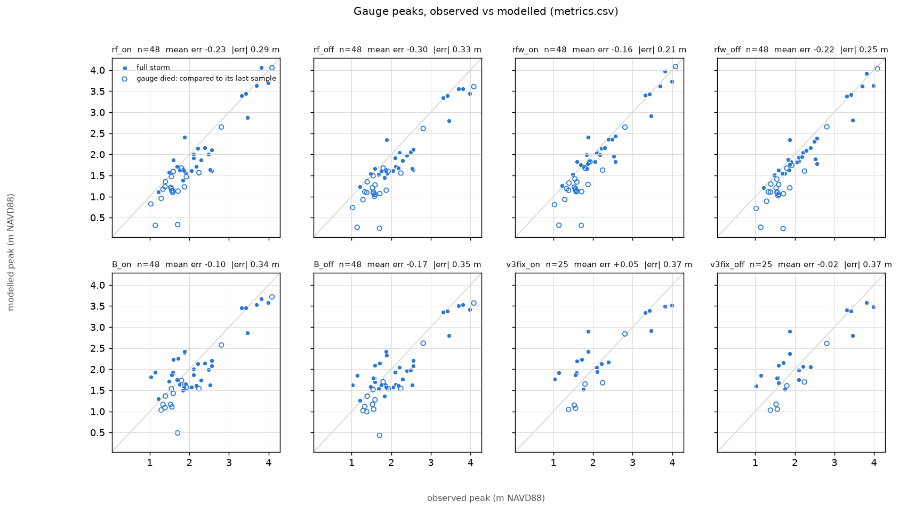


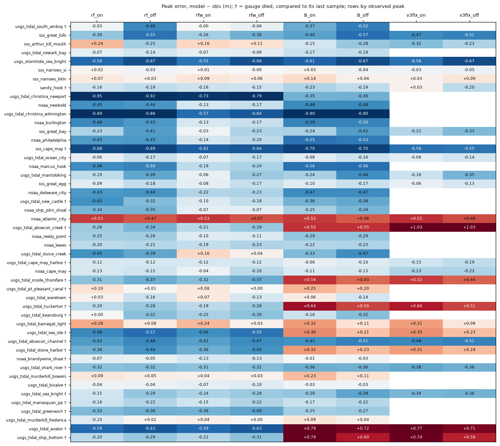


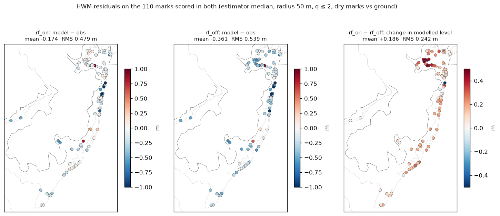


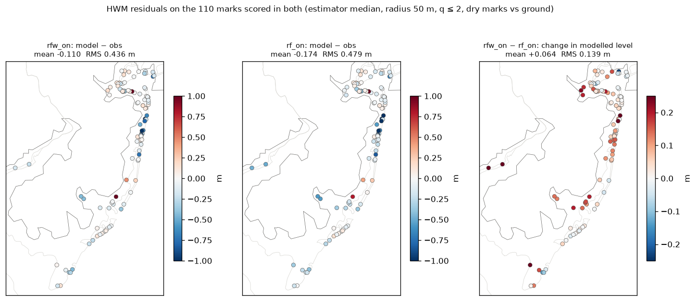


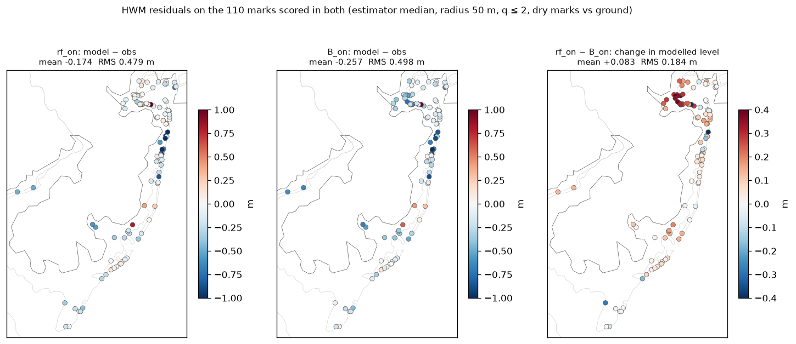


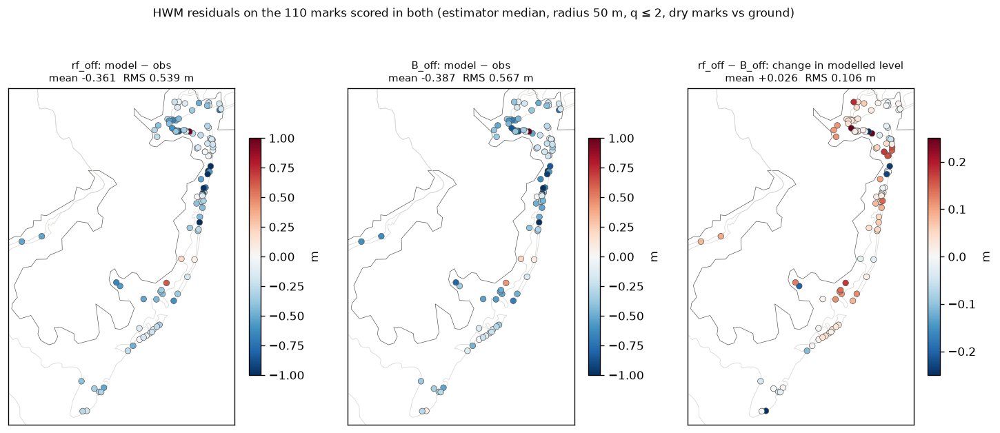


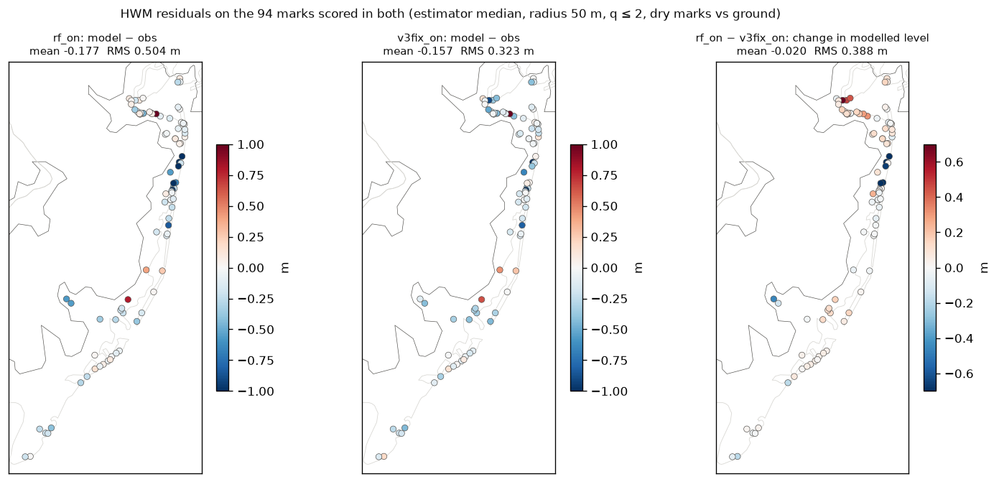


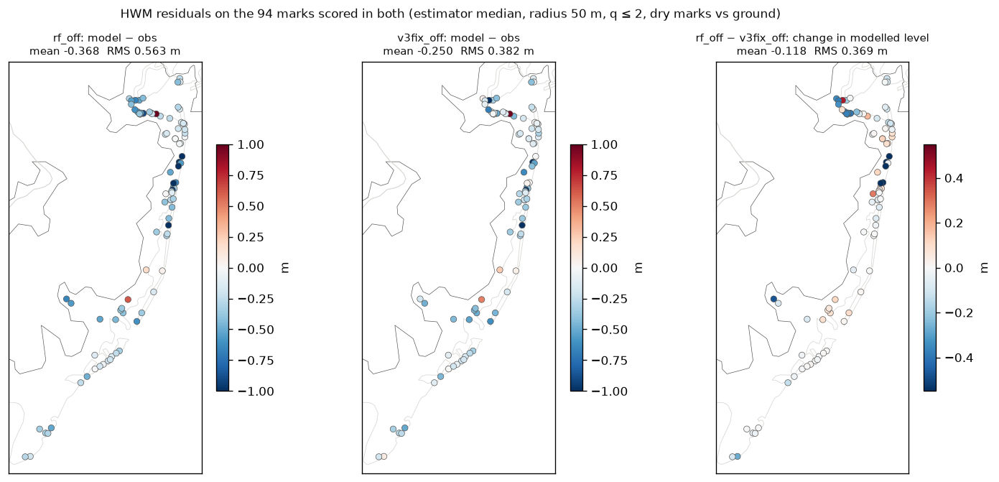


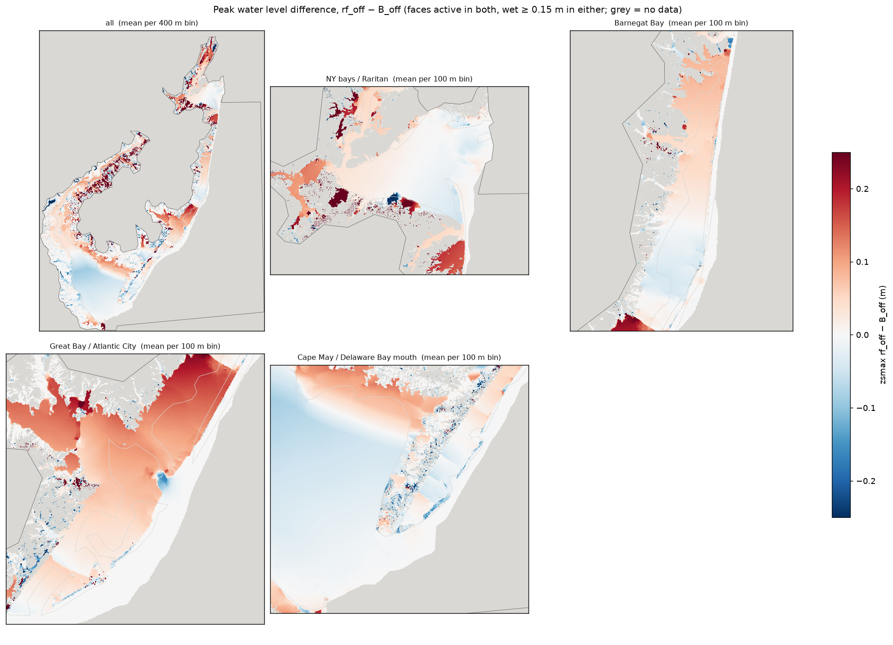


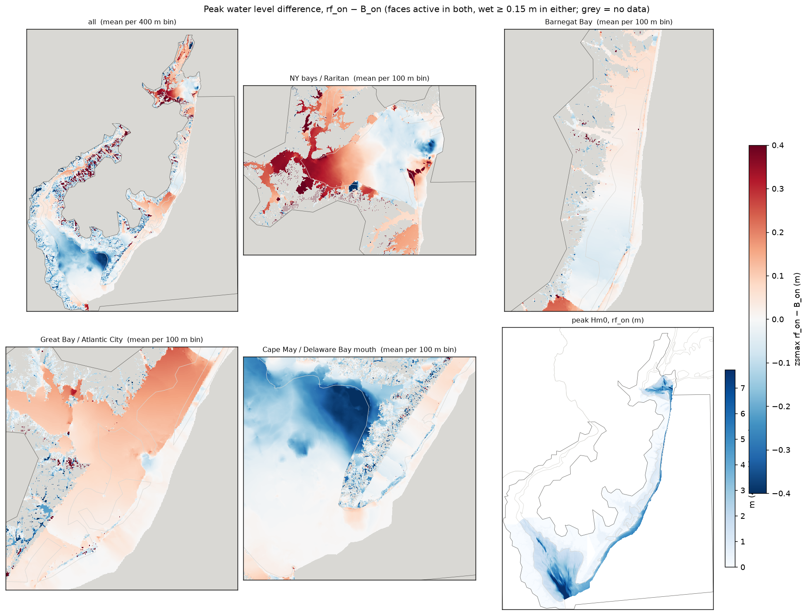


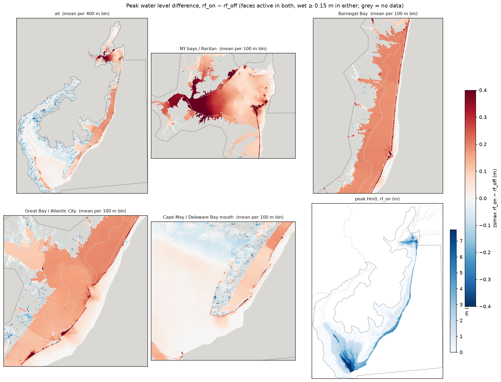


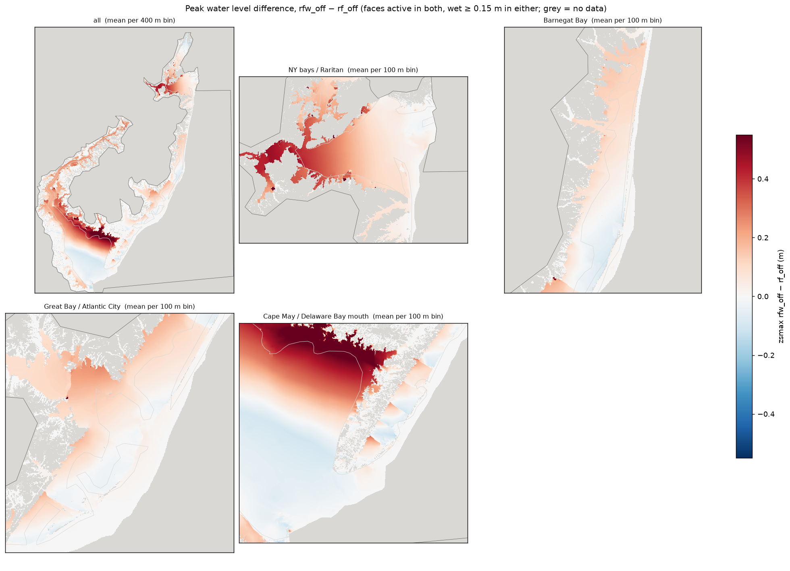


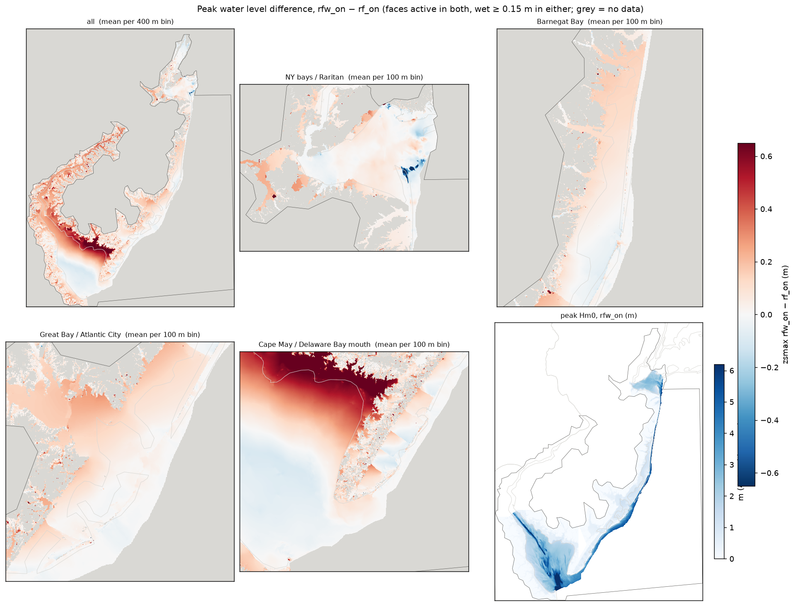


## What is running

```
     JOBID                     NAME     STATE       TIME  TIME_LIMIT NODELIST(REASON)
  62418789              v4_det_test   PENDING       0:00     9:00:00 (Priority)
  62419793     v4_refreeze_validate   PENDING       0:00     8:00:00 (Dependency)
  62328665            v4_swing_test   RUNNING    9:11:59    14:00:00 hal0394
  62419752 v4_refreeze_naccs-nowave   RUNNING       8:15     4:00:00 hal0276
  62418378                v4rf_read   RUNNING      25:43     3:00:00 hal0380
```


## Caveats

- **`rf_on` resumed with its soil reset to dry** at 10-29 12:00 (`restart_history.txt`), so it over-infiltrates later rain. It affects the rain-pond marks: `south_coast` −0.3 m against an uninterrupted twin. For a clean reference, re-run it or use `rfw_*`.
- **v4 waves-on is not run-to-run repeatable.** Lone 64-thread copies differ too: zsmax p99 2.4 cm, single gauges up to 0.1 m in 3 h (FINDINGS §44). Treat a few-cm Δ at an NY-bay gauge as noise.
- **The NY-bay waves-on crest carries a ~3 h basin seiche** amplified by the waves (±0.1–0.15 m).
- **Seven southern back-bay gauges** have a valid `peak_err` only on `v4_refreeze` (FINDINGS §60f).
- **Gauges on uncarved creeks** read flat, smoothed series (§60g): Sluice Creek, Greenwich, Frederica, Christina.
- **CSI is not comparable across domains.** Waves-off CSI is kept but not ranked against waves-on.
- **The by-design list** (`reports/v4_refreeze_list_2026-10-05.md`): rivers cut at today's head of tide; the Schuylkill below Fairmount on a fill bed; no measured bed under the 2010-lidar back-bay candidates.


## Reproduce

```bash
# canonical paired_hwm_bootstrap.py reads (same-domain pairs; one at a time):
NJ_DOMAIN=v4_refreeze python scripts/paired_hwm_bootstrap.py /cache/home/tpj8/nj_bight_sfincs/experiments/v4_refreeze/naccs-premier /cache/home/tpj8/nj_bight_sfincs/experiments/v4_refreeze/naccs-nowaves --by-basin
NJ_DOMAIN=v4_refreeze python scripts/paired_hwm_bootstrap.py /cache/home/tpj8/nj_bight_sfincs/experiments/v4_refreeze/wind-naccs+naccs-nowaves /cache/home/tpj8/nj_bight_sfincs/experiments/v4_refreeze/naccs-nowaves --by-basin
NJ_DOMAIN=v4_refreeze python scripts/paired_hwm_bootstrap.py /cache/home/tpj8/nj_bight_sfincs/experiments/v4_refreeze/wind-naccs+naccs-premier /cache/home/tpj8/nj_bight_sfincs/experiments/v4_refreeze/naccs-premier --by-basin
```
