# First waves-on v4 results — 2026-10-11

_Generated by `scripts/v4_first_results.py report`; tables are auto-filled, every **TODO** is prose for the main session. HWM numbers: estimator **median**, radius **50 m**, q ≤ 2, dry marks scored against ground (the `_scored` keys)._

## The short version

TODO — two or three plain sentences: did the waves help the marks, where, and by how much (paired, with the CI); anything that looks wrong.

## What ran

| label | role | domain | arm | engine | waves | dtwave_s | dtheta_deg | ig | rain | infiltration | subgrid | solve_wall_h | sim_h_per_wall_h | nodes | constraint | audit | seal |
|---|---|---|---|---|---|---|---|---|---|---|---|---|---|---|---|---|---|
| pv4_on | v4 premier, waves ON | v4_refreeze | naccs-premier | bin:v2.3.3-winddir-fix-1-gf11@673ee3bf | ON | 3600.0 | 5.0 | 1 | on | cna | _subgrid_refreeze@b6f29ad1 | 10.08 | 7.14 | hal0395 | emeraldrapids | output WHOLE | 4881654 faces, sha 378014e154b4ff41; sealed |
| pv4_off | v4 premier's waves-off twin | v4_refreeze | naccs-nowaves | bin:v2.3.3-winddir-fix-1-gf11@673ee3bf | off |  |  |  | on | cna | _subgrid_refreeze@b6f29ad1 | 2.20 | 32.76 | hal0340 |  | output WHOLE | 4881654 faces, sha 378014e154b4ff41; sealed |
| ni_on | v4 premier, infiltration OFF (= v3's rain), waves ON | v4_refreeze | naccs-premier+rain-noinfil | bin:v2.3.3-winddir-fix-1-gf11@673ee3bf | ON | 3600.0 | 5.0 | 1 | on | none | _subgrid_refreeze@b6f29ad1 | 15.10 | 4.77 | hal0386 | emeraldrapids | output WHOLE | 4881654 faces, sha 378014e154b4ff41; sealed |
| ni_off | v4 infiltration OFF, waves off | v4_refreeze | naccs-nowaves+rain-noinfil | bin:v2.3.3-winddir-fix-1-gf11@673ee3bf | off |  |  |  | on | none | _subgrid_refreeze@b6f29ad1 | 15.10 | 4.77 | hal0386 | emeraldrapids | output WHOLE | 4881654 faces, sha 378014e154b4ff41; sealed |
| v3n_on | v3 reference candidate: shared bed fixes, hourly waves, NACCS wind | v3 | bed-v4fixes+wave-dt3600+wind-naccs | bin:v2.3.3-winddir-fix-1-gf11@673ee3bf | ON | 3600.0 | 5.0 | 1 | on | none | _subgrid_v4fixes@183ce59b | 15.58 | 4.62 | hal0384 | emeraldrapids | output WHOLE | 3412470 faces, sha 1596ce1ecc71b374; sealed |
| v3n_off | its waves-off twin | v3 | bed-v4fixes+naccs-nowaves+wind-naccs | bin:v2.3.3-winddir-fix-1-gf11@673ee3bf | off |  |  |  | on | none | _subgrid_v4fixes@183ce59b | 15.58 | 4.62 | hal0384 | emeraldrapids | output WHOLE | 3412470 faces, sha 1596ce1ecc71b374; sealed |


## Headline scores (metrics.csv)

HWM on the `_scored` keys; MOTF CSI/POD/FAR with `extent_admissible` (False = waves-off: keep, do not rank against waves-on) and `motf_km2_excluded_boxes` (v3 and v4 score DIFFERENT MOTF rasters — CSI is not comparable across domains).

| label | domain | arm | hwm_estimator | hwm_radius_m | hwm_n_scored | hwm_n_dry_scored | hwm_bias_scored_m | hwm_rmse_scored_m | hwm_within0.5_scored | motf_csi | motf_pod | motf_far | extent_admissible | motf_km2_excluded_boxes | motf_km2_excluded_invalid | motf_csi_connected | motf_far_connected |
|---|---|---|---|---|---|---|---|---|---|---|---|---|---|---|---|---|---|
| pv4_on | v4_refreeze | naccs-premier | median | 50.000 | 110 | 1 | -0.110 | 0.436 | 0.909 | 0.780 | 0.853 | 0.098 | True | 2413.653 | 2413.653 | 0.822 | 0.042 |
| pv4_off | v4_refreeze | naccs-nowaves | median | 50.000 | 110 | 3 | -0.240 | 0.490 | 0.836 | 0.770 | 0.829 | 0.085 | False | 2413.653 | 2413.653 | 0.808 | 0.030 |
| ni_on | v4_refreeze | naccs-premier+rain-noinfil | median | 50.000 | 110 | 0 | -0.034 | 0.307 | 0.945 | 0.763 | 0.874 | 0.143 | True | 2413.653 | 2413.653 | 0.821 | 0.069 |
| ni_off | v4_refreeze | naccs-nowaves+rain-noinfil | median | 50.000 | 110 | 2 | -0.172 | 0.344 | 0.900 | 0.754 | 0.851 | 0.132 | False | 2413.653 | 2413.653 | 0.811 | 0.055 |
| v3n_on | v3 | bed-v4fixes+wave-dt3600+wind-naccs | median | 50.000 | 94 | 0 | -0.097 | 0.300 | 0.915 | 0.717 | 0.897 | 0.219 | True | 14.038 | 0.000 | 0.820 | 0.095 |
| v3n_off | v3 | bed-v4fixes+naccs-nowaves+wind-naccs | median | 50.000 | 94 | 1 | -0.213 | 0.357 | 0.872 | 0.711 | 0.870 | 0.204 | False | 14.038 | 0.000 | 0.809 | 0.080 |


TODO — one paragraph reading the table.


## Paired comparisons (per-mark, bootstrap)

Δ = A − B. ΔRMSE < 0 means A fits the marks better. Δ mean / Δ median = change in modelled level at the marks (positive = A higher). ALL row = `paired_hwm_bootstrap.py` main read (B = 200 000, seed 20261007); groups = its `--by-basin` read. Cross-domain pairs are joined on `hwm_id` over the marks scored in both (v3's area).

| pair | why | domains | n | rmse_a | rmse_b | drmse_m | drmse_lo | drmse_hi | p_a_better | bias_a | bias_b | dmean_m | dmedian_m |
|---|---|---|---|---|---|---|---|---|---|---|---|---|---|
| ni_on − v3n_on | v4 vs v3, like for like (no infiltration), waves on | v4_refreeze / v3 | 94 | +0.3177 | +0.3004 | +0.0172 | -0.0308 | +0.0569 | +0.2568 | -0.0408 | -0.0974 | +0.0566 | +0.0687 |
| ni_off − v3n_off | v4 vs v3, like for like, waves off | v4_refreeze / v3 | 94 | +0.3563 | +0.3574 | -0.0011 | -0.0373 | +0.0348 | +0.5566 | -0.1857 | -0.2133 | +0.0276 | +0.0246 |
| pv4_on − v3n_on | v4 premier (CN infiltration) vs v3, waves on | v4_refreeze / v3 | 94 | +0.4622 | +0.3004 | +0.1618 | +0.0101 | +0.3153 | +0.0106 | -0.1219 | -0.0974 | -0.0245 | +0.0306 |
| ni_on − pv4_on | infiltration off vs on, waves on | v4_refreeze / v4_refreeze | 110 | +0.3070 | +0.4359 | -0.1290 | -0.2596 | -0.0096 | +0.9941 | -0.0342 | -0.1102 | +0.0759 | +0.0294 |
| ni_off − pv4_off | infiltration off vs on, waves off | v4_refreeze / v4_refreeze | 110 | +0.3436 | +0.4900 | -0.1465 | -0.2724 | -0.0292 | +1.0000 | -0.1725 | -0.2401 | +0.0676 | +0.0109 |
| ni_on − ni_off | wave contribution, no infiltration | v4_refreeze / v4_refreeze | 110 | +0.3070 | +0.3436 | -0.0366 | -0.0741 | -0.0041 | +0.9863 | -0.0342 | -0.1725 | +0.1382 | +0.1261 |
| v3n_on − v3n_off | v3 wave contribution, NACCS wind | v3 / v3 | 94 | +0.3004 | +0.3574 | -0.0570 | -0.0875 | -0.0283 | +1.0000 | -0.0974 | -0.2133 | +0.1160 | +0.1114 |


### By basin group

| pair | unit | n | drmse_m | drmse_lo | drmse_hi | dmean_m | dmean_lo | dmean_hi | dmedian_m | bias_a | bias_b |
|---|---|---|---|---|---|---|---|---|---|---|---|
| ni_on − v3n_on | [open coast] | 23 | +0.031 | -0.092 | +0.120 | +0.026 | -0.030 | +0.076 | +0.059 | -0.087 | -0.114 |
| ni_on − v3n_on | [inlets] | 14 | -0.005 | -0.042 | +0.036 | +0.002 | -0.066 | +0.063 | +0.003 | -0.170 | -0.173 |
| ni_on − v3n_on | [NY bays] | 38 | +0.027 | -0.071 | +0.085 | +0.105 | +0.076 | +0.137 | +0.084 | +0.052 | -0.053 |
| ni_on − v3n_on | [NJ back bays] | 19 | +0.004 | -0.043 | +0.046 | +0.036 | -0.022 | +0.082 | +0.021 | -0.074 | -0.110 |
| ni_off − v3n_off | [open coast] | 23 | +0.019 | -0.074 | +0.110 | +0.011 | -0.049 | +0.063 | +0.031 | -0.262 | -0.273 |
| ni_off − v3n_off | [inlets] | 14 | -0.023 | -0.067 | +0.027 | +0.017 | -0.066 | +0.088 | +0.008 | -0.303 | -0.320 |
| ni_off − v3n_off | [NY bays] | 38 | -0.000 | -0.073 | +0.047 | +0.045 | +0.013 | +0.079 | +0.017 | -0.072 | -0.117 |
| ni_off − v3n_off | [NJ back bays] | 19 | -0.008 | -0.047 | +0.031 | +0.021 | -0.040 | +0.065 | +0.033 | -0.235 | -0.256 |
| pv4_on − v3n_on | [open coast] | 23 | +0.271 | -0.051 | +0.506 | -0.085 | -0.243 | +0.032 | +0.011 | -0.199 | -0.114 |
| pv4_on − v3n_on | [inlets] | 14 | +0.033 | -0.038 | +0.154 | -0.044 | -0.166 | +0.045 | -0.031 | -0.217 | -0.173 |
| pv4_on − v3n_on | [NY bays] | 38 | +0.012 | -0.068 | +0.055 | +0.066 | +0.037 | +0.097 | +0.055 | +0.013 | -0.053 |
| pv4_on − v3n_on | [NJ back bays] | 19 | +0.305 | -0.009 | +0.712 | -0.118 | -0.396 | +0.045 | -0.009 | -0.228 | -0.110 |
| ni_on − pv4_on | [open coast] | 23 | -0.240 | -0.395 | -0.006 | +0.112 | +0.016 | +0.228 | +0.011 | -0.087 | -0.199 |
| ni_on − pv4_on | [inlets] | 14 | -0.038 | -0.125 | +0.002 | +0.046 | +0.014 | +0.101 | +0.008 | -0.170 | -0.217 |
| ni_on − pv4_on | [NY bays] | 46 | +0.013 | -0.008 | +0.029 | +0.037 | +0.031 | +0.043 | +0.037 | +0.030 | -0.007 |
| ni_on − pv4_on | [NJ back bays] | 19 | -0.301 | -0.708 | -0.006 | +0.153 | +0.026 | +0.379 | +0.028 | -0.074 | -0.228 |
| ni_on − pv4_on | [rivers / Newark Bay] | 7 | -0.003 | -0.052 | +0.039 | +0.052 | +0.032 | +0.075 | +0.052 | +0.068 | +0.016 |
| ni_off − pv4_off | [open coast] | 23 | -0.270 | -0.439 | -0.012 | +0.139 | +0.014 | +0.271 | +0.012 | -0.262 | -0.401 |
| ni_off − pv4_off | [inlets] | 14 | -0.039 | -0.098 | -0.012 | +0.046 | +0.020 | +0.086 | +0.020 | -0.303 | -0.349 |
| ni_off − pv4_off | [NY bays] | 46 | +0.004 | -0.002 | +0.010 | +0.008 | +0.004 | +0.012 | +0.002 | -0.091 | -0.098 |
| ni_off − pv4_off | [NJ back bays] | 19 | -0.309 | -0.696 | -0.019 | +0.163 | +0.029 | +0.395 | +0.028 | -0.235 | -0.399 |
| ni_off − pv4_off | [rivers / Newark Bay] | 7 | -0.013 | -0.028 | +0.012 | +0.020 | +0.010 | +0.030 | +0.016 | -0.005 | -0.025 |
| ni_on − ni_off | [open coast] | 23 | -0.069 | -0.163 | -0.028 | +0.175 | +0.140 | +0.210 | +0.163 | -0.087 | -0.262 |
| ni_on − ni_off | [inlets] | 14 | -0.063 | -0.103 | -0.031 | +0.132 | +0.092 | +0.172 | +0.103 | -0.170 | -0.303 |
| ni_on − ni_off | [NY bays] | 46 | -0.004 | -0.075 | +0.043 | +0.120 | +0.101 | +0.143 | +0.120 | +0.030 | -0.091 |
| ni_on − ni_off | [NJ back bays] | 19 | -0.054 | -0.132 | +0.024 | +0.161 | +0.134 | +0.185 | +0.193 | -0.074 | -0.235 |
| ni_on − ni_off | [rivers / Newark Bay] | 7 | -0.007 | -0.071 | +0.054 | +0.073 | +0.048 | +0.101 | +0.076 | +0.068 | -0.005 |
| v3n_on − v3n_off | [open coast] | 23 | -0.081 | -0.140 | -0.035 | +0.159 | +0.123 | +0.197 | +0.119 | -0.114 | -0.273 |
| v3n_on − v3n_off | [inlets] | 14 | -0.081 | -0.132 | -0.040 | +0.147 | +0.102 | +0.189 | +0.153 | -0.173 | -0.320 |
| v3n_on − v3n_off | [NY bays] | 38 | -0.023 | -0.075 | +0.014 | +0.063 | +0.047 | +0.081 | +0.049 | -0.053 | -0.117 |
| v3n_on − v3n_off | [NJ back bays] | 19 | -0.067 | -0.132 | +0.005 | +0.146 | +0.119 | +0.172 | +0.147 | -0.110 | -0.256 |


Per-basin rows: `paired.csv`.


TODO — the wave contribution in plain words (which basins move, how much), run B vs A, and v4 vs v3 on the shared marks.


### Residual self-check (per-mark recompute vs the metrics.csv row)

| label | n | rmse | bias | metrics_n | metrics_rmse | metrics_bias | metrics_estimator | metrics_radius | reproduces_metrics_4dp |
|---|---|---|---|---|---|---|---|---|---|
| ni_off | 110 | 0.3436 | -0.1725 | 110 | 0.3436 | -0.1725 | median | 50.0000 | True |
| ni_on | 110 | 0.3070 | -0.0342 | 110 | 0.3070 | -0.0342 | median | 50.0000 | True |
| rfw_off | 110 | 0.4900 | -0.2401 | 110 | 0.4900 | -0.2401 | median | 50.0000 | True |
| rfw_on | 110 | 0.4359 | -0.1102 | 110 | 0.4359 | -0.1102 | median | 50.0000 | True |
| v3n_off | 94 | 0.3574 | -0.2133 | 94 | 0.3574 | -0.2133 | median | 50.0000 | True |
| v3n_on | 94 | 0.3004 | -0.0974 | 94 | 0.3004 | -0.0974 | median | 50.0000 | True |


## Gauges (peak, model − obs, m)

† = the gauge died mid-storm; model compared to its last good sample.


| index | obs_peak | pv4_on | pv4_off | ni_on | ni_off | v3n_on | v3n_off |
|---|---|---|---|---|---|---|---|
| noaa_atlantic_city | +1.88 | +0.53 | +0.47 | +0.53 | +0.47 | +0.54 | +0.49 |
| noaa_brandywine_shoal † | +1.54 | -0.13 | -0.13 | -0.12 | -0.13 |  |  |
| noaa_burlington | +2.48 | -0.13 | -0.17 | -0.03 | -0.13 |  |  |
| noaa_cape_may | +1.75 | -0.04 | -0.20 | +0.03 | -0.20 | -0.23 | -0.25 |
| noaa_delaware_city | +2.05 | -0.22 | -0.23 | -0.15 | -0.22 |  |  |
| noaa_lewes | +1.85 | -0.19 | -0.23 | -0.19 | -0.23 |  |  |
| noaa_marcus_hook | +2.17 | -0.19 | -0.24 | -0.08 | -0.21 |  |  |
| noaa_newbold | +2.56 | -0.13 | -0.17 | -0.04 | -0.13 |  |  |
| noaa_philadelphia | +2.29 | -0.14 | -0.20 | -0.05 | -0.16 |  |  |
| noaa_reedy_point | +1.87 | -0.10 | -0.11 | -0.08 | -0.10 |  |  |
| noaa_ship_john_shoal | +1.90 | -0.07 | -0.07 | +0.02 | -0.07 |  |  |
| sandy_hook † | +2.81 | -0.16 | -0.15 | -0.15 | -0.15 | -0.18 | -0.18 |
| sss_arthur_kill_mouth | +3.81 | +0.16 | +0.11 | +0.21 | +0.11 | +0.12 | +0.12 |
| sss_cape_may † | +2.24 | -0.62 | -0.64 | -0.58 | -0.64 | -0.57 | -0.54 |
| sss_great_bay | +2.39 | -0.03 | -0.23 | +0.01 | -0.18 | -0.02 | -0.16 |
| sss_great_egg | +2.10 | -0.08 | -0.17 | -0.04 | -0.14 | -0.05 | -0.13 |
| sss_great_kills | +3.99 | -0.26 | -0.36 | -0.25 | -0.36 | -0.37 | -0.39 |
| sss_narrows_bkln | +3.32 | +0.09 | +0.06 | +0.12 | +0.06 | +0.05 | +0.05 |
| sss_narrows_si | +3.42 | +0.01 | -0.00 | +0.03 | -0.00 | -0.03 | -0.02 |
| usgs_stormtide_sea_bright | +3.47 | -0.55 | -0.66 | -0.55 | -0.66 | -0.53 | -0.66 |
| usgs_tidal_absecon_channel † | +1.56 | -0.41 | -0.47 | -0.40 | -0.47 | -0.44 | -0.48 |
| usgs_tidal_absecon_creek † | +1.87 | -0.21 | -0.29 | -0.21 | -0.28 | +1.04 | +1.05 |
| usgs_tidal_avalon † | +1.14 | -0.59 | -0.63 | -0.58 | -0.63 | +0.85 | +0.76 |
| usgs_tidal_barnegat_light | +1.59 | +0.24 | +0.03 | +0.25 | +0.04 | +0.27 | +0.03 |
| usgs_tidal_bivalve † | +1.39 | -0.07 | -0.10 | -0.09 | -0.10 |  |  |
| usgs_tidal_cape_may_harbor † | +1.80 | -0.12 | -0.12 | -0.12 | -0.12 | -0.15 | -0.22 |
| usgs_tidal_christina_newport | +2.56 | -0.73 | -0.79 | -0.69 | -0.76 |  |  |
| usgs_tidal_christina_wilmington | +2.52 | -0.57 | -0.64 | -0.49 | -0.61 |  |  |
| usgs_tidal_greenwich † | +1.29 | -0.36 | -0.40 | -0.38 | -0.40 |  |  |
| usgs_tidal_inside_thorofare † | +1.71 | -0.32 | -0.37 | -0.32 | -0.37 | +0.60 | +0.49 |
| usgs_tidal_keansburg † | +1.59 | -0.25 | -0.30 | -0.19 | -0.31 |  |  |
| usgs_tidal_manasquan_pp † | +1.33 | -0.15 | -0.22 | -0.15 | -0.22 |  |  |
| usgs_tidal_mantoloking | +2.11 | -0.06 | -0.27 | -0.01 | -0.22 | -0.02 | -0.24 |
| usgs_tidal_murderkill_bowers | +1.48 | +0.04 | +0.03 | +0.04 | +0.03 |  |  |
| usgs_tidal_murderkill_frederica | +1.21 | +0.04 | +0.00 | +0.47 | +0.43 |  |  |
| usgs_tidal_new_castle † | +1.92 | -0.10 | -0.18 | -0.09 | -0.16 |  |  |
| usgs_tidal_newark_bay | +3.70 | -0.07 | -0.08 | -0.06 | -0.08 |  |  |
| usgs_tidal_ocean_city | +2.21 | -0.07 | -0.17 | -0.06 | -0.15 | -0.01 | -0.14 |
| usgs_tidal_pt_pleasant_canal † | +1.70 | +0.08 | +0.00 | +0.08 | +0.00 |  |  |
| usgs_tidal_sea_bright † | +1.38 | -0.24 | -0.28 | -0.24 | -0.28 | -0.34 | -0.36 |
| usgs_tidal_sea_isle † | +1.58 | -0.46 | -0.55 | -0.45 | -0.54 | +0.35 | +0.20 |
| usgs_tidal_shark_river † | +1.53 | -0.31 | -0.32 | -0.31 | -0.32 | -0.36 | -0.36 |
| usgs_tidal_ship_bottom † | +1.02 | -0.22 | -0.31 | -0.22 | -0.30 | +0.73 | +0.55 |
| usgs_tidal_sluice_creek | +1.83 | +0.16 | +0.04 | +0.39 | +0.23 |  |  |
| usgs_tidal_south_amboy † | +4.09 | -0.00 | -0.06 | +0.05 | -0.05 |  |  |
| usgs_tidal_stone_harbor † | +1.55 | -0.36 | -0.45 | -0.36 | -0.44 | +0.23 | +0.14 |
| usgs_tidal_tuckerton † | +1.59 | -0.19 | -0.28 | -0.19 | -0.28 | +0.65 | +0.53 |
| usgs_tidal_waretown | +1.68 | +0.07 | -0.13 | +0.10 | -0.10 |  |  |


TODO — which gauges the waves move, and the worst misses.


## HWM by basin (metrics.csv, `_scored` keys)

| basin  | n_scored ni_off | n_scored ni_on | n_scored pv4_off | n_scored pv4_on | n_scored v3n_off | n_scored v3n_on | bias_scored_m ni_off | bias_scored_m ni_on | bias_scored_m pv4_off | bias_scored_m pv4_on | bias_scored_m v3n_off | bias_scored_m v3n_on | rmse_scored_m ni_off | rmse_scored_m ni_on | rmse_scored_m pv4_off | rmse_scored_m pv4_on | rmse_scored_m v3n_off | rmse_scored_m v3n_on |
|---|---|---|---|---|---|---|---|---|---|---|---|---|---|---|---|---|---|---|
| absecon_atlantic_city | +9.000 | +9.000 | +9.000 | +9.000 | +9.000 | +9.000 | -0.163 | +0.019 | -0.172 | +0.008 | -0.191 | -0.036 | +0.184 | +0.076 | +0.193 | +0.071 | +0.217 | +0.104 |
| arthur_kill_nj | +3.000 | +3.000 | +3.000 | +3.000 |  |  | +0.073 | +0.111 | +0.066 | +0.088 |  |  | +0.109 | +0.140 | +0.108 | +0.121 |  |  |
| atlantic_oceanfront | +3.000 | +3.000 | +3.000 | +3.000 | +3.000 | +3.000 | -0.135 | -0.020 | -0.153 | -0.053 | -0.258 | -0.086 | +0.154 | +0.086 | +0.171 | +0.099 | +0.267 | +0.203 |
| barnegat_barrier | +1.000 | +1.000 | +1.000 | +1.000 | +1.000 | +1.000 | -0.272 | -0.059 | -0.323 | -0.103 | -0.271 | -0.049 | +0.272 | +0.059 | +0.323 | +0.103 | +0.271 | +0.049 |
| barnegat_bay | +6.000 | +6.000 | +6.000 | +6.000 | +6.000 | +6.000 | -0.365 | -0.182 | -0.742 | -0.552 | -0.312 | -0.129 | +0.443 | +0.309 | +1.095 | +1.002 | +0.433 | +0.295 |
| brooklyn_breezy | +3.000 | +3.000 | +3.000 | +3.000 |  |  | -0.370 | -0.363 | -0.370 | -0.365 |  |  | +0.454 | +0.447 | +0.454 | +0.452 |  |  |
| cape_may | +2.000 | +2.000 | +2.000 | +2.000 | +2.000 | +2.000 | -0.245 | -0.029 | -0.246 | -0.033 | -0.042 | +0.053 | +0.250 | +0.166 | +0.252 | +0.169 | +0.183 | +0.203 |
| cape_may_back_bays | +4.000 | +4.000 | +4.000 | +4.000 | +4.000 | +4.000 | -0.378 | -0.279 | -0.393 | -0.290 | -0.398 | -0.302 | +0.403 | +0.307 | +0.420 | +0.319 | +0.412 | +0.320 |
| delaware_bay_shore | +1.000 | +1.000 | +1.000 | +1.000 |  |  | -0.033 | +0.199 | -0.037 | +0.037 |  |  | +0.033 | +0.199 | +0.037 | +0.037 |  |  |
| delaware_river | +2.000 | +2.000 | +2.000 | +2.000 |  |  | -0.231 | -0.109 | -0.270 | -0.201 |  |  | +0.233 | +0.116 | +0.271 | +0.203 |  |  |
| great_bay_mullica | +9.000 | +9.000 | +9.000 | +9.000 | +9.000 | +9.000 | -0.086 | +0.088 | -0.172 | +0.017 | -0.156 | -0.012 | +0.379 | +0.393 | +0.446 | +0.426 | +0.400 | +0.387 |
| great_egg | +2.000 | +2.000 | +2.000 | +2.000 | +2.000 | +2.000 | -0.340 | -0.218 | -0.380 | -0.243 | -0.283 | -0.152 | +0.365 | +0.220 | +0.393 | +0.243 | +0.334 | +0.163 |
| lbi_barrier | +4.000 | +4.000 | +4.000 | +4.000 | +4.000 | +4.000 | -0.273 | -0.060 | -0.290 | -0.076 | -0.374 | -0.166 | +0.354 | +0.221 | +0.371 | +0.229 | +0.462 | +0.321 |
| lower_bay_si_shore | +6.000 | +6.000 | +6.000 | +6.000 | +3.000 | +3.000 | -0.209 | -0.047 | -0.214 | -0.074 | -0.267 | -0.177 | +0.272 | +0.134 | +0.275 | +0.151 | +0.301 | +0.210 |
| manasquan | +10.000 | +10.000 | +10.000 | +10.000 | +10.000 | +10.000 | -0.268 | -0.117 | -0.297 | -0.139 | -0.333 | -0.155 | +0.402 | +0.345 | +0.418 | +0.345 | +0.442 | +0.351 |
| raritan_bay | +21.000 | +21.000 | +21.000 | +21.000 | +19.000 | +19.000 | -0.036 | +0.106 | -0.044 | +0.054 | -0.055 | +0.013 | +0.367 | +0.385 | +0.360 | +0.362 | +0.356 | +0.348 |
| raritan_river | +2.000 | +2.000 | +2.000 | +2.000 |  |  | +0.104 | +0.182 | +0.083 | +0.126 |  |  | +0.119 | +0.190 | +0.097 | +0.136 |  |  |
| sandy_hook_bay | +4.000 | +4.000 | +4.000 | +4.000 | +4.000 | +4.000 | -0.131 | -0.019 | -0.136 | -0.050 | -0.222 | -0.160 | +0.142 | +0.054 | +0.145 | +0.066 | +0.241 | +0.171 |
| shark_river | +2.000 | +2.000 | +2.000 | +2.000 | +2.000 | +2.000 | -0.437 | -0.389 | -0.573 | -0.578 | -0.289 | -0.281 | +0.439 | +0.402 | +0.581 | +0.584 | +0.417 | +0.429 |
| shrewsbury_navesink | +12.000 | +12.000 | +12.000 | +12.000 | +12.000 | +12.000 | -0.043 | +0.049 | -0.056 | +0.022 | -0.142 | -0.092 | +0.076 | +0.098 | +0.079 | +0.081 | +0.148 | +0.111 |
| south_coast | +4.000 | +4.000 | +4.000 | +4.000 | +4.000 | +4.000 | -0.576 | -0.442 | -1.308 | -1.006 | -0.482 | -0.356 | +0.759 | +0.699 | +1.469 | +1.297 | +0.596 | +0.533 |


## Gauge peaks, paired (modelled A − B, m)

Obs cancels: this is how much each pair's change moves the modelled peak.


| gauge | ni_on − v3n_on | ni_off − v3n_off | pv4_on − v3n_on | ni_on − pv4_on | ni_off − pv4_off | ni_on − ni_off | v3n_on − v3n_off |
|---|---|---|---|---|---|---|---|
| noaa_atlantic_city | -0.011 | -0.020 | -0.010 | -0.000 | -0.000 | +0.056 | +0.047 |
| noaa_brandywine_shoal |  |  |  | +0.007 | +0.000 | +0.011 |  |
| noaa_burlington |  |  |  | +0.091 | +0.041 | +0.099 |  |
| noaa_cape_may | +0.260 | +0.045 | +0.189 | +0.071 | +0.001 | +0.231 | +0.016 |
| noaa_delaware_city |  |  |  | +0.066 | +0.010 | +0.068 |  |
| noaa_lewes |  |  |  | -0.008 | +0.000 | +0.034 |  |
| noaa_marcus_hook |  |  |  | +0.110 | +0.025 | +0.135 |  |
| noaa_newbold |  |  |  | +0.093 | +0.043 | +0.091 |  |
| noaa_philadelphia |  |  |  | +0.083 | +0.038 | +0.106 |  |
| noaa_reedy_point |  |  |  | +0.013 | +0.007 | +0.016 |  |
| noaa_ship_john_shoal |  |  |  | +0.092 | +0.005 | +0.092 |  |
| sandy_hook | +0.029 | +0.024 | +0.014 | +0.015 | +0.001 | +0.007 | +0.001 |
| sss_arthur_kill_mouth | +0.088 | -0.003 | +0.034 | +0.054 | +0.000 | +0.096 | +0.005 |
| sss_cape_may | -0.013 | -0.099 | -0.045 | +0.032 | +0.000 | +0.055 | -0.031 |
| sss_great_bay | +0.036 | -0.020 | -0.009 | +0.045 | +0.051 | +0.196 | +0.141 |
| sss_great_egg | +0.010 | -0.014 | -0.022 | +0.032 | +0.033 | +0.097 | +0.072 |
| sss_great_kills | +0.125 | +0.029 | +0.116 | +0.009 | +0.000 | +0.115 | +0.019 |
| sss_narrows_bkln | +0.075 | +0.013 | +0.039 | +0.035 | -0.000 | +0.065 | +0.003 |
| sss_narrows_si | +0.055 | +0.020 | +0.037 | +0.018 | +0.000 | +0.028 | -0.007 |
| usgs_stormtide_sea_bright | -0.019 | +0.004 | -0.019 | +0.000 | +0.000 | +0.107 | +0.129 |
| usgs_tidal_absecon_channel | +0.034 | +0.008 | +0.032 | +0.002 | +0.001 | +0.066 | +0.040 |
| usgs_tidal_absecon_creek | -1.626 | -1.712 | -1.629 | +0.002 | +0.002 | +0.079 | -0.007 |
| usgs_tidal_avalon | -1.667 | -1.633 | -1.669 | +0.002 | +0.000 | +0.049 | +0.082 |
| usgs_tidal_barnegat_light | -0.019 | +0.009 | -0.029 | +0.009 | +0.010 | +0.209 | +0.238 |
| usgs_tidal_bivalve |  |  |  | -0.013 | +0.000 | +0.009 |  |
| usgs_tidal_cape_may_harbor | +0.025 | +0.097 | +0.025 | +0.000 | +0.000 | +0.002 | +0.074 |
| usgs_tidal_christina_newport |  |  |  | +0.045 | +0.034 | +0.069 |  |
| usgs_tidal_christina_wilmington |  |  |  | +0.082 | +0.025 | +0.119 |  |
| usgs_tidal_greenwich |  |  |  | -0.021 | +0.001 | +0.020 |  |
| usgs_tidal_inside_thorofare | -1.195 | -1.138 | -1.199 | +0.004 | +0.000 | +0.053 | +0.110 |
| usgs_tidal_keansburg |  |  |  | +0.054 | -0.000 | +0.114 |  |
| usgs_tidal_manasquan_pp |  |  |  | +0.001 | +0.001 | +0.075 |  |
| usgs_tidal_mantoloking | +0.009 | +0.014 | -0.038 | +0.046 | +0.050 | +0.212 | +0.217 |
| usgs_tidal_murderkill_bowers |  |  |  | +0.002 | +0.002 | +0.010 |  |
| usgs_tidal_murderkill_frederica |  |  |  | +0.428 | +0.429 | +0.040 |  |
| usgs_tidal_new_castle |  |  |  | +0.018 | +0.022 | +0.077 |  |
| usgs_tidal_newark_bay |  |  |  | +0.010 | +0.002 | +0.015 |  |
| usgs_tidal_ocean_city | -0.049 | -0.009 | -0.061 | +0.013 | +0.014 | +0.097 | +0.137 |
| usgs_tidal_pt_pleasant_canal |  |  |  | +0.001 | +0.000 | +0.077 |  |
| usgs_tidal_sea_bright | +0.097 | +0.080 | +0.101 | -0.004 | +0.000 | +0.039 | +0.022 |
| usgs_tidal_sea_isle | -0.798 | -0.747 | -0.807 | +0.009 | +0.009 | +0.093 | +0.143 |
| usgs_tidal_shark_river | +0.054 | +0.037 | +0.053 | +0.001 | -0.000 | +0.019 | +0.002 |
| usgs_tidal_ship_bottom | -0.945 | -0.850 | -0.946 | +0.001 | +0.001 | +0.090 | +0.184 |
| usgs_tidal_sluice_creek |  |  |  | +0.237 | +0.193 | +0.161 |  |
| usgs_tidal_south_amboy |  |  |  | +0.052 | +0.001 | +0.105 |  |
| usgs_tidal_stone_harbor | -0.594 | -0.588 | -0.596 | +0.003 | +0.004 | +0.082 | +0.087 |
| usgs_tidal_tuckerton | -1.111 | -1.075 | -1.112 | +0.001 | +0.001 | +0.083 | +0.119 |
| usgs_tidal_waretown |  |  |  | +0.022 | +0.025 | +0.198 |  |


## Peak water level, face by face (zsmax A − B, m)

Faces active in both runs and wet ≥ 0.15 m in either; basins = the domain's HWM basin rules applied to face centres. Maps: `zsmax/fig_zsmax_*.png`.


Median Δ per basin:

| basin | ni_on − pv4_on | ni_off − pv4_off | ni_on − ni_off | v3n_on − v3n_off |
|---|---|---|---|---|
| ALL wet faces | +0.032 | +0.009 | +0.097 | +0.085 |
| absecon_atlantic_city | +0.005 | +0.008 | +0.107 | +0.088 |
| arthur_kill_nj | +0.026 | +0.003 | +0.035 |  |
| atlantic_oceanfront | +0.001 | +0.000 | +0.062 | +0.051 |
| barnegat_barrier | +0.000 | +0.000 | +0.069 | +0.069 |
| barnegat_bay | +0.040 | +0.045 | +0.206 | +0.215 |
| brooklyn_breezy | +0.001 | +0.000 | +0.006 |  |
| cape_may | +0.011 | +0.000 | +0.089 | +0.027 |
| cape_may_back_bays | +0.009 | +0.010 | +0.090 | +0.083 |
| delaware_bay_de | +0.067 | +0.005 | +0.067 |  |
| delaware_bay_nj_upper | +0.099 | +0.030 | +0.115 |  |
| delaware_bay_shore | +0.139 | +0.003 | +0.164 | +0.094 |
| delaware_river | +0.083 | +0.035 | +0.063 |  |
| delaware_river_upper | +0.111 | +0.070 | +0.089 |  |
| great_bay_mullica | +0.019 | +0.020 | +0.185 | +0.138 |
| great_egg | +0.013 | +0.019 | +0.092 | +0.083 |
| lbi_barrier | +0.019 | +0.020 | +0.195 | +0.191 |
| lower_bay_si_shore | +0.024 | +0.000 | +0.079 | +0.005 |
| manasquan | +0.045 | +0.050 | +0.155 | +0.184 |
| newark_bay | +0.012 | +0.012 | +0.007 |  |
| raritan_bay | +0.050 | +0.001 | +0.102 | +0.006 |
| raritan_river | +0.055 | +0.020 | +0.077 |  |
| sandy_hook_bay | +0.014 | +0.000 | +0.075 | +0.006 |
| shark_river | +0.002 | +0.002 | +0.014 | +0.000 |
| shrewsbury_navesink | +0.036 | +0.021 | +0.122 | +0.108 |
| south_coast | +0.000 | +0.000 | +0.061 | +0.043 |


95th percentile Δ per basin:

| basin | ni_on − pv4_on | ni_off − pv4_off | ni_on − ni_off | v3n_on − v3n_off |
|---|---|---|---|---|
| ALL wet faces | +0.200 | +0.178 | +0.210 | +0.224 |
| absecon_atlantic_city | +0.141 | +0.153 | +0.192 | +0.178 |
| arthur_kill_nj | +0.074 | +0.063 | +0.083 |  |
| atlantic_oceanfront | +0.037 | +0.022 | +0.630 | +0.605 |
| barnegat_barrier | +0.042 | +0.047 | +0.388 | +0.378 |
| barnegat_bay | +0.152 | +0.157 | +0.211 | +0.222 |
| brooklyn_breezy | +0.074 | +0.052 | +0.046 |  |
| cape_may | +0.154 | +0.136 | +0.260 | +0.124 |
| cape_may_back_bays | +0.146 | +0.133 | +0.178 | +0.192 |
| delaware_bay_de | +0.192 | +0.202 | +0.141 |  |
| delaware_bay_nj_upper | +0.198 | +0.188 | +0.178 |  |
| delaware_bay_shore | +0.225 | +0.105 | +0.228 | +0.103 |
| delaware_river | +0.406 | +0.422 | +0.133 |  |
| delaware_river_upper | +0.476 | +0.477 | +0.104 |  |
| great_bay_mullica | +0.171 | +0.180 | +0.215 | +0.219 |
| great_egg | +0.116 | +0.125 | +0.181 | +0.177 |
| lbi_barrier | +0.024 | +0.027 | +0.216 | +0.237 |
| lower_bay_si_shore | +0.051 | +0.085 | +0.481 | +0.091 |
| manasquan | +0.247 | +0.254 | +0.231 | +0.293 |
| newark_bay | +0.184 | +0.187 | +0.015 |  |
| raritan_bay | +0.106 | +0.060 | +0.192 | +0.126 |
| raritan_river | +0.064 | +0.034 | +0.088 |  |
| sandy_hook_bay | +0.044 | +0.016 | +0.175 | +0.661 |
| shark_river | +0.569 | +0.824 | +0.724 | +0.761 |
| shrewsbury_navesink | +0.102 | +0.095 | +0.130 | +0.117 |
| south_coast | +0.979 | +0.997 | +0.595 | +0.557 |


TODO — where the waves raise the peak, in words.


## Figures


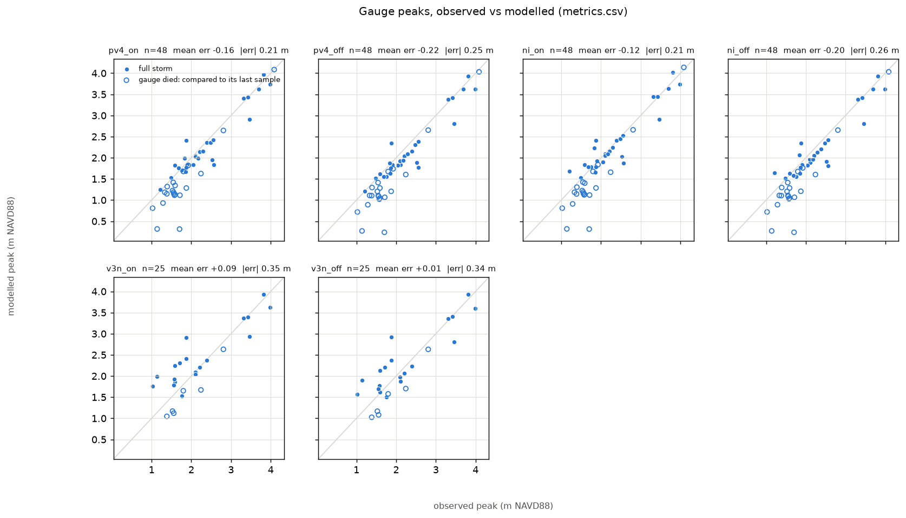


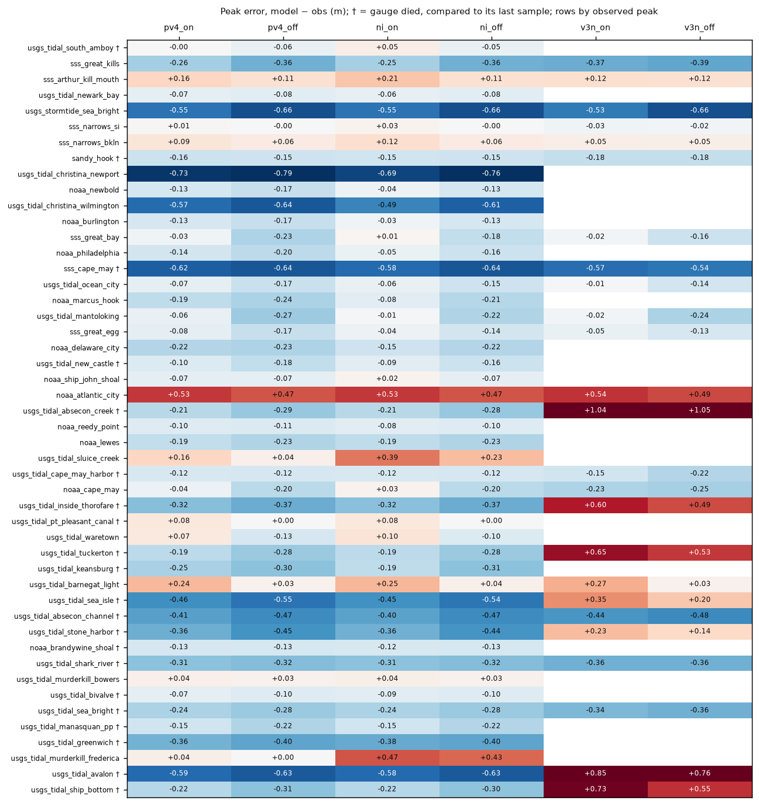


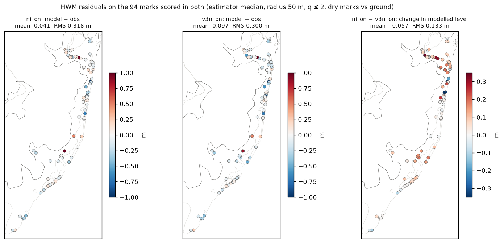


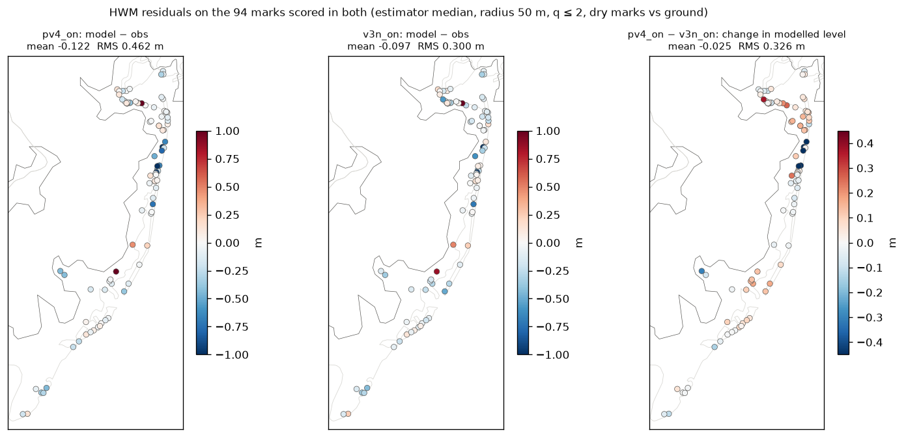


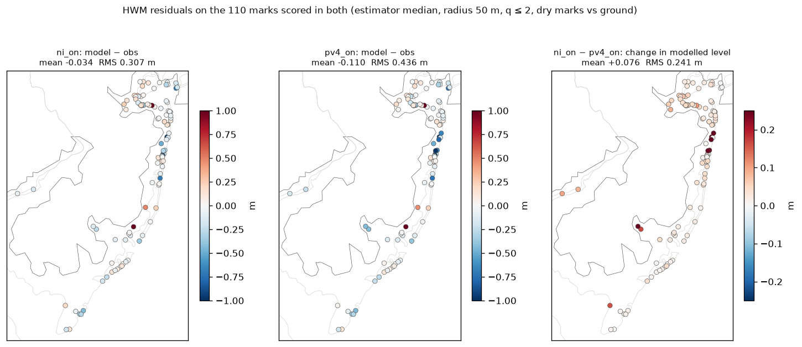


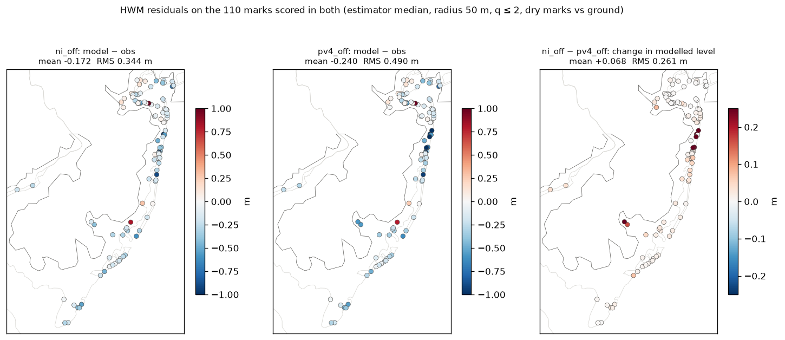


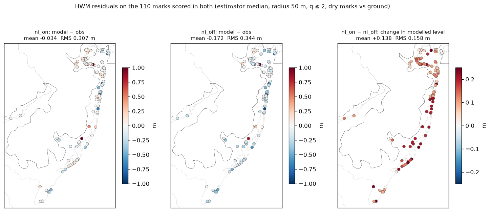


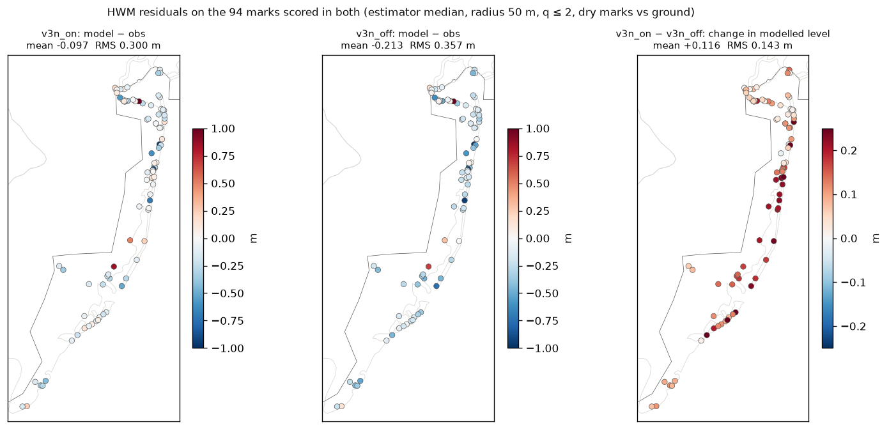


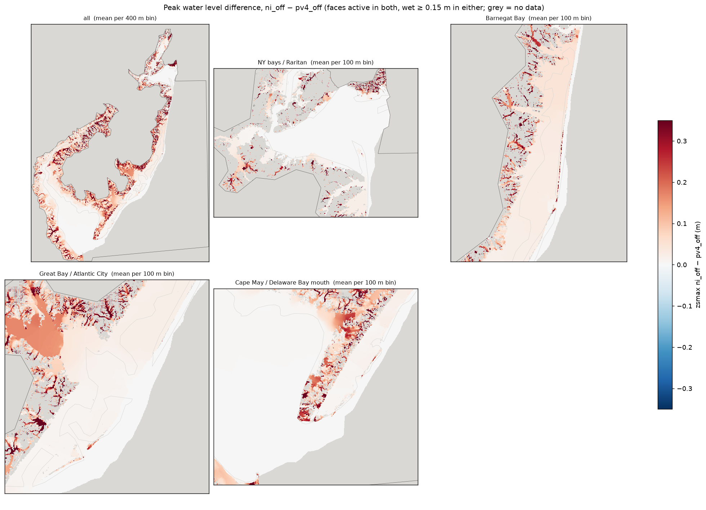


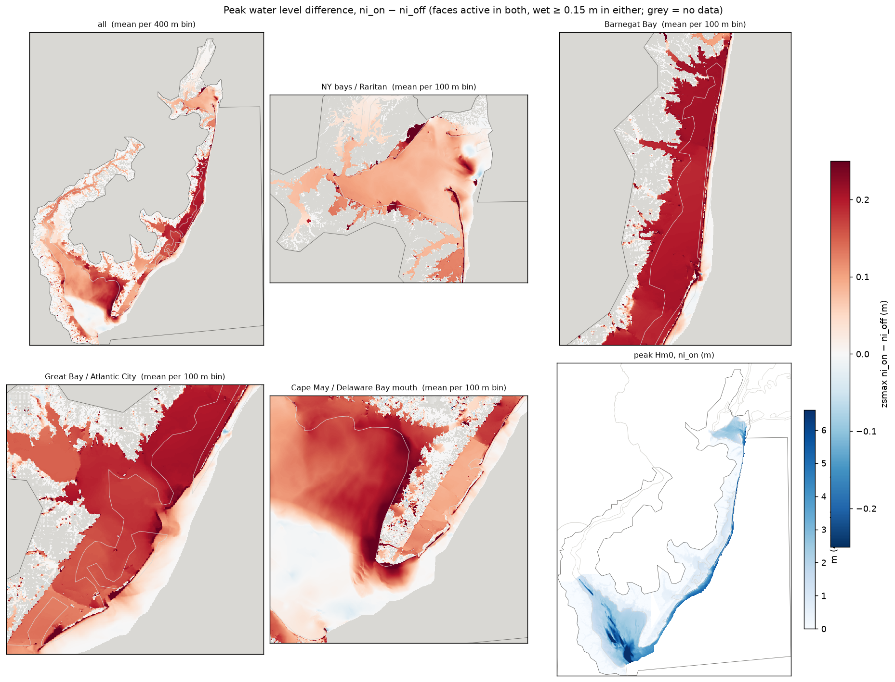


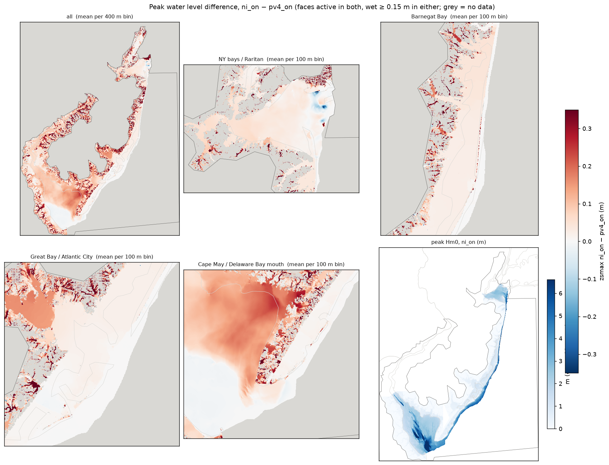


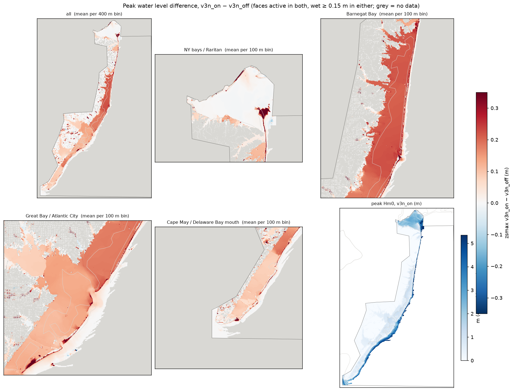


## What is running

```
     JOBID                     NAME     STATE       TIME  TIME_LIMIT NODELIST(REASON)
  62625419                   ig_det   PENDING       0:00     4:00:00 (Priority)
  62625422              agri-golden   RUNNING       0:43     6:00:00 hal0350
  62625293               v4_v3_read   RUNNING      15:28     3:00:00 hal0383
  62625122                   vscode   RUNNING      26:39     9:00:00 hal0446
```


## Caveats

TODO — imperfect-by-design list (reports/v4_refreeze_list_2026-10-05.md), anything flagged above.


## Reproduce

```bash
# canonical paired_hwm_bootstrap.py reads (same-domain pairs; one at a time):
NJ_DOMAIN=v4_refreeze python scripts/paired_hwm_bootstrap.py /cache/home/tpj8/nj_bight_sfincs/experiments/v4_refreeze/naccs-premier+rain-noinfil /cache/home/tpj8/nj_bight_sfincs/experiments/v4_refreeze/naccs-premier --by-basin
NJ_DOMAIN=v4_refreeze python scripts/paired_hwm_bootstrap.py /cache/home/tpj8/nj_bight_sfincs/experiments/v4_refreeze/naccs-nowaves+rain-noinfil /cache/home/tpj8/nj_bight_sfincs/experiments/v4_refreeze/naccs-nowaves --by-basin
NJ_DOMAIN=v4_refreeze python scripts/paired_hwm_bootstrap.py /cache/home/tpj8/nj_bight_sfincs/experiments/v4_refreeze/naccs-premier+rain-noinfil /cache/home/tpj8/nj_bight_sfincs/experiments/v4_refreeze/naccs-nowaves+rain-noinfil --by-basin
NJ_DOMAIN=v3 python scripts/paired_hwm_bootstrap.py /cache/home/tpj8/nj_bight_sfincs/experiments/v3/bed-v4fixes+wave-dt3600+wind-naccs /cache/home/tpj8/nj_bight_sfincs/experiments/v3/bed-v4fixes+naccs-nowaves+wind-naccs --by-basin
```
